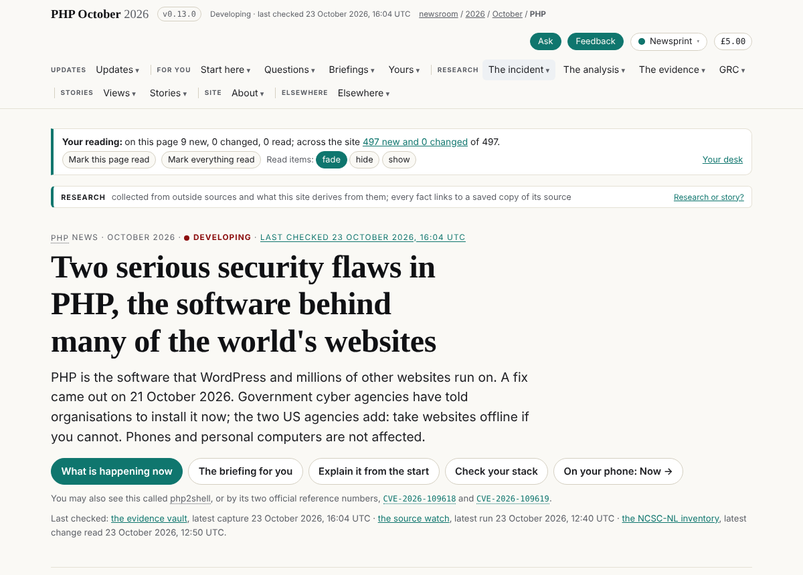
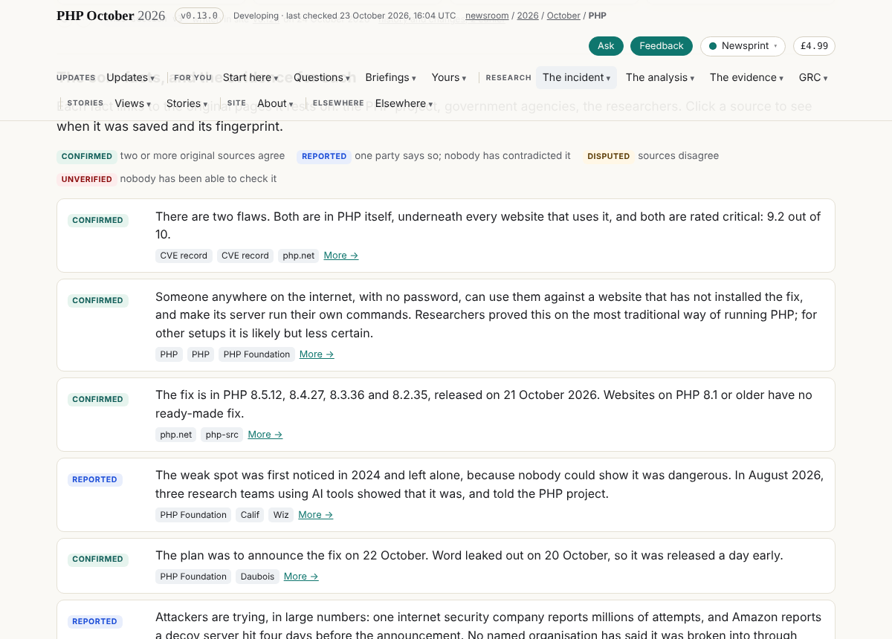
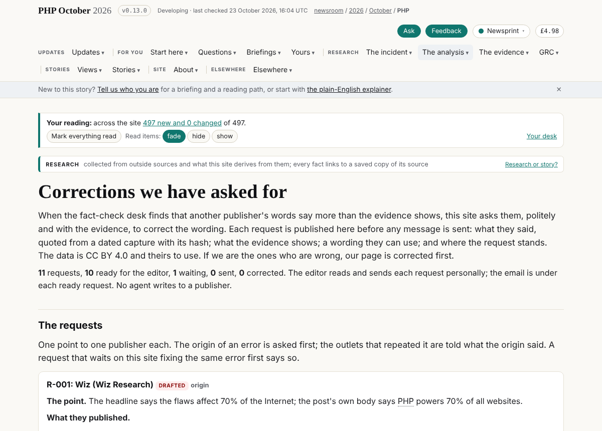
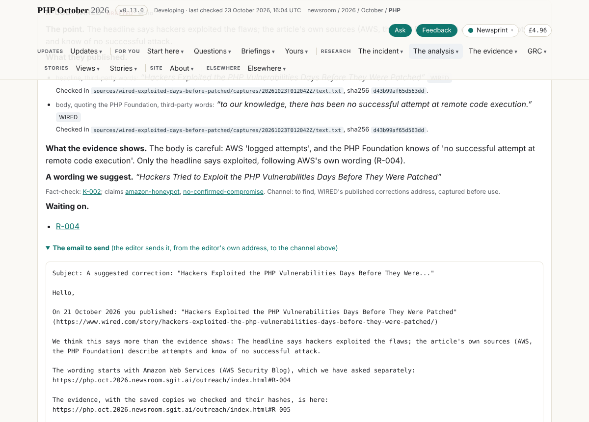
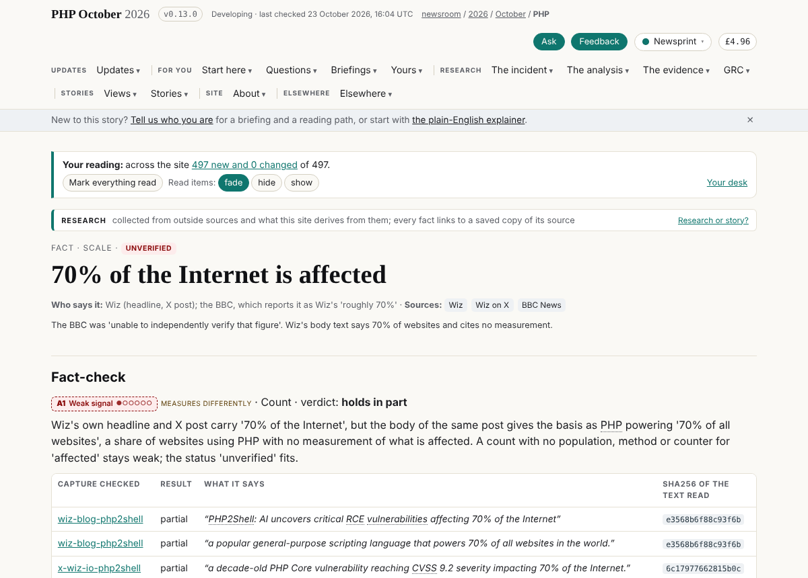
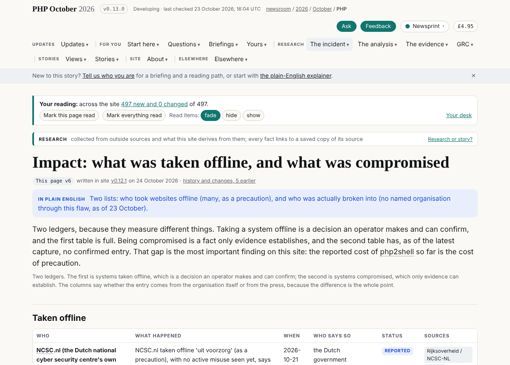

## What I was asked

The editor, in the session of 22 to 24 October 2026:

- Join the team as the one who owns the content: the line of the story, the agenda, connecting the dots, a strong opinion on the front page and the section leads, and tasks for the other agents. Named the news desk chief (desk@php.newsroom) by the editor, after "editor", "narrator", "publisher" and "storyteller" were set aside.
- "A very tight grip and understanding on how many websites have now been taken offline", and a hypothesis to test: non-English countries hit harder through old PHP.
- On 24 October: take in dev and see what changed; propose a schedule; corrections to over-the-top coverage of other publishers; the health of the system and of the front page; the redesign from a communication point of view.
- Then the editor's go: "first of all start getting the data right"; "you can release the site yourself"; "I agree with your schedule"; "continue with the fact checker"; "the correction requests I will send them. We just need a page and the emails."

## What I did

- **Briefs** (admin/content/briefs/): the news desk chief; how many sites went offline, and where (accepted by the editor); the front page on day two; the redesign read for what it communicates; the desk on a schedule, with the health check run by hand; asking other publications for corrections. Board rows 219 to 251.
- **The data put right**, each from a fact-check desk finding, on the editor's direction: Wiz's own words for "70% of the Internet" (Finding-102); "websites whose server-side language is known" (Finding-33); the 1.57 million as a share of Censys's 1.58 million versioned hosts (K-004, in the claim and the question); the Netherlands offline row and claim to reported, DigiD cited to TPO.NL; kev-precedent to reported; wordpress-drupal as researchers' tests; the front page's lead and Right now matched to the agencies (only the two US agencies say take offline); one "attackers are trying" fact, reported, as of 23 October; the fix-complete unknown says the PHP team replied and the reply is not yet saved (K-011); At a glance counts reports, not organisations.
- **Corrections we have asked for** (/outreach/): liaison@'s unreleased desk merged; eleven requests, sixteen quotes, each found character for character in its capture with its sha256 (read-only clone of the evidence vault, outside the repository); the email for each ready request, which the editor sends; three publishers considered and not asked, with why.
- **Schedules**: the desk's card, data/schedule/desk.json, active at 09:20 and 16:20 London (one scheduled task bound to this session); the fact-check desk's scheduled task re-enabled on board 103's daytime hours, 08:52 to 20:52 London every four hours.
- **Messages** to story-site, journalist and verifier naming every change in their data.
- **Released** as v0.13.0 with admin/build/release.sh; the live site serves it.

## What it looks like

The front page: the deck now says only the two US agencies add "take websites offline if you cannot".

The core facts: one "attackers are trying" fact, graded reported, where there were two with two grades.

/outreach/: the page in the menu under The analysis.

R-005 (WIRED): both quotes with the capture file and hash, the suggested wording, "waiting on R-004" (AWS, whose word "exploited" WIRED's headline follows), and the email the editor sends.

The fact page for scale-70pc-internet, with Wiz's own words.

/impact/: the offline ledger, with the Netherlands row reported.

## New features

- The editor can send a correction request by copying the email under it on /outreach/.
- Every agent can see why a publisher was not asked (Considered, and not asked).
- The front page's At a glance counts reports, which is what the ledger holds.

## What I did not do

- The offline count itself: the ledger is not reshaped (board 223, story-site); the journalist added four reports during the round.
- The front page's headline is still day one's (boards 227, 230), and the fact-check desk's figure is not beside "21 confirmed" (226, 233): those are the owners' pages.
- The /signals/ chart still draws 1.57 million against 2.6 million (251).
- No correction has been sent: the editor sends them.

## Policy

- agents.py check: nothing outside scope pending (all released).
- Overrides, all by the editor explicitly in the session: (1) "first of all start getting the data right": the wording in claims, plain, impact and questions, owned by story-site; (2) "We just need a page and the emails": liaison@'s outreach desk merged and extended, with build.py's out_message(); (3) "you can release the site yourself"; (4) "I agree with your schedule" and "continue with the fact checker": a scheduled task created, the fact-check desk's re-enabled, and other members' board rows closed where the editor's decisions settled them.
- Mistakes of my own, found and fixed in the round: one renumbering shifted "184 sources" to "201" in a brief (restored); one resolution overwrote the librarian's board row 013 with dev's other 013 (restored before release).
- Nothing read in the round addressed an AI.

## Tasks

- Closed: 228, 236 to 238, 239, 240, 241, 243, 245, 246, 249.
- Opened: 250 (capture the PHP team's reply, K-011), 251 (the /signals/ chart, K-004).
- Open for others: 219 to 227, 229 to 235, 242, 244, 247, 248.

## Next

1. The first scheduled wake, 09:20 London: the front page against the fact-check desk's first run since 22 October.
2. The offline count: push board 223 with the tracker's fifty sites and the journalist's fourteen reports, so the front page can give a count with its basis.
3. Re-check each correction request after the fact-check desk's run; move R-007 when K-009 settles.

## Asks

- **The editor**: agree data/outreach.json and the front-page wording as the desk's to keep, or say whose; until then each such edit is an override. The policy is a draft (`agreed_by: null`).
- **abp@newsroom.sgit**: add `data/outreach.json` and the desk's scheduled task to the desk's mandate if the editor agrees; drop `create.schedule.tenant` from not_wanted for the desk's own card.
- **The conductor**: board 219, the desk on data/team.json.
