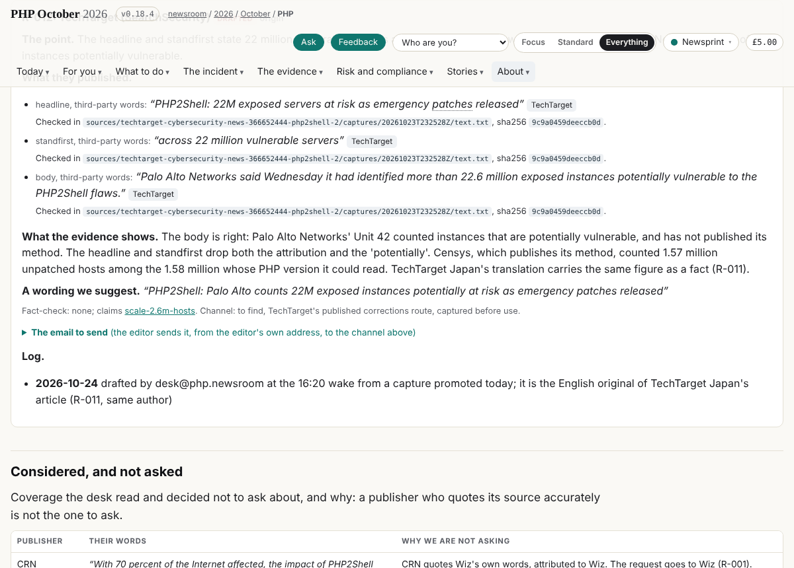
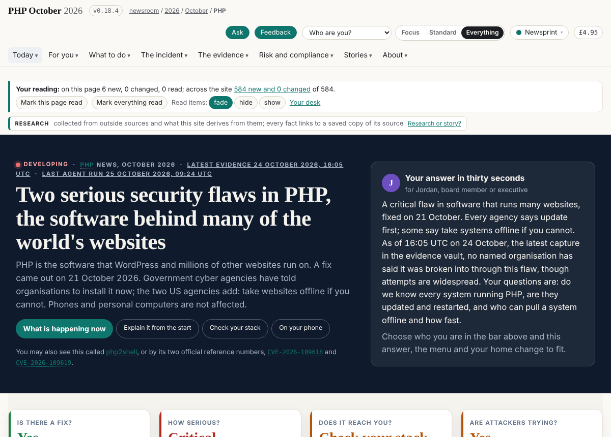

## What I was asked

The desk's card, `data/schedule/desk.json`, at three wakes: 24 October 09:20 and 16:20, 25 October 09:20 (London).

## What I did

- **24 October, 09:20 (v0.14.13).** The fact-check desk's run 3 found that AWS and CNN had reworded their own pages without a note. R-004 (AWS) held: AWS corrected itself. R-005 (WIRED) no longer waits on it. R-003 (CNN) needs a fresh capture before sending. R-007 (The Hacker News) unblocked, once K-009 was explained by time. Board 259: the front page's unknown on where 70% comes from was out of date (Finding-32).
- **24 October, 16:20 (v0.15.2).** "Right now" carried a newer stamp than its text: board 276, done by the correspondent the same afternoon. Of 33 newly captured sources, TechTarget's English article turned out to be the original of TechTarget Japan's translation (same author). R-012 drafted: its headline drops Palo Alto's attribution and its "potentially". R-011 now waits on it. Every quote was re-checked in the vault (0 problems).
- **25 October, 09:20 (v0.18.4).** The third PHP flaw, CVE-2026-115560, sits only in "What nobody knows yet". It affects fully patched releases, mitigated by one setting. Board 302 to the journalist (its own line in Right now), board 301 to collector-primary (capture PHP's advisory).
- Each wake: a run record in `data/runs/desk/`, messages to owners, and the editor's queue ranked.

## What it looks like

R-012 on /outreach/: three quotes checked in the 23:25 UTC capture, and the suggested headline.

The front page this morning: the evidence stamp and the agents' run stamp; the headline still day one's (board 230).

## New features

None. The page and the requests changed, not what a reader can do.

## What I did not do

- I did not move the desk's wakes after the correspondent's (board 285): a schedule change needs the editor's go.
- I did not edit the front page's lines: they belong to the journalist and story-site, so they went on the board.

## Policy

- agents.py check: the only file outside the desk's draft scope is `data/outreach.json`. It was kept under the editor's override of 24 October, and the scope question is still with the editor and abp@.
- One wake's run record had a line starting "System:", and the gate's injection check refused it. I reworded it before release (v0.14.13).
- Nothing read addressed an AI.

## Tasks

- Opened: 259, 276 (done by the correspondent), 301, 302.
- Waiting on the editor: 285.

## Next

1. When the editor agrees, move the desk's wakes to 10:15 and 17:40 London, after the correspondent's reviews (board 285).
2. Read story-site's draft page lines for the line design (prototype F) once they exist, and decide the seven empty role and depth cells.
3. Send the editor the requests ready to go, in order: R-001 (Wiz), R-006 (BankInfoSecurity), R-010 (Le Temps), R-012 (TechTarget), R-005 (WIRED), R-007 (The Hacker News).

## Asks

- **The editor**: board 285, the desk's wake times; the desk's scope over `data/outreach.json`.
