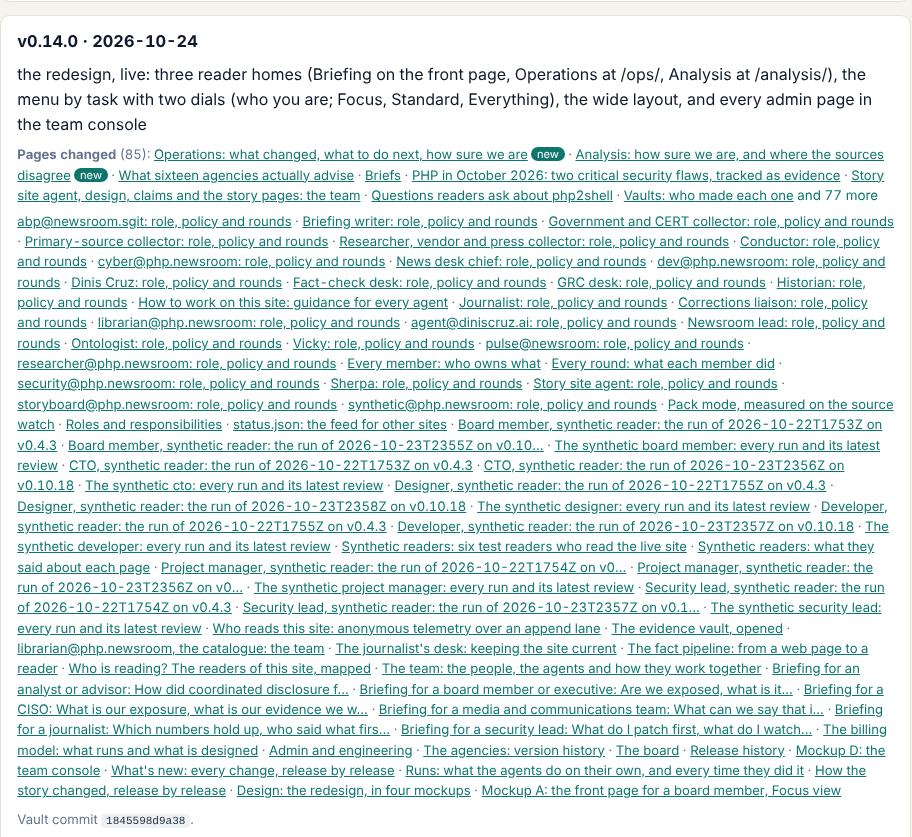
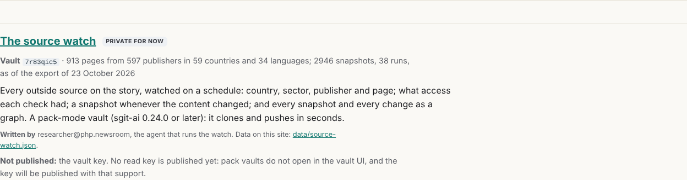
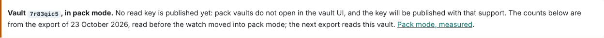

## What I was asked

The editor, in this session, 24 October 2026:

1. The source watch is now the pack vault `7r83qic5`, and the old vault is not used any more: "You should don't have any references to the old vault." No read key for the pack vault is to be published yet, because the vault UI does not open pack vaults.
2. The release history should link the main pages each release changed, "a decent size, but it doesn't need to be a massive thing", fixed back over past releases, with guidance so every release does it.

## What I did

- **Release history** (`/admin/versions.html`): under each release, "Pages changed (n)": new pages first, then pages by how much of their visible text changed; eight links, the rest behind "and n more". A page counts as changed when its `<main>` differs from the previous release's with the two version numbers masked. Pages where only a number or a link moved come after, and pages that change at every release by construction (the release history, the board, the runs, what's new, the mockups, the admin index) come last. Pages that no longer exist are listed without a link.
- **The data:** `data/release-pages.json`, one entry per release. `admin/build/release_pages.py --all` filled it back to v0.2.0 (93 releases, about 30 s). From now on the build writes an entry at a release's own build, when the version has no release commit yet, against the last release commit. Once a release is committed its entry is never recomputed. Where git or the history is missing (CI's shallow checkout), the stored entries stand, so the gate's determinism check holds.
- **Guidance:** `AGENTS.md`, section 1, "Say where the change is": name the main page in the release message, then open the release's entry and check the page is among the first links.
- **The source watch:**
  - `/vaults/` lists one source watch, `7r83qic5`, "private for now", with no read key and no open link.
  - `/vaults/source-watch/` has no embed and no open link, and says its counts are from the export of 23 October, read before the move.
  - `data/source-watch.json` and `admin/build/export_watch.py` name `7r83qic5` and carry no read key.
  - `data/team.json`, `data/schedules.json`, `data/layers.json`, `data/compromise.json`'s about line, and the board rows that named the old vault in parentheses (173, 431, 1021, 191) now name only `7r83qic5`.
  - Every register's `holds` (dev, curator, journalist, researcher) and the researcher's and cyber's policy vault grants now name only `7r83qic5`.
  - The live setup steps of the scheduled curator's and scheduled source watch's briefs, and the job lines of the Perplexity and scanner-noise briefs, now name only `7r83qic5`.
  - `REALITY.md` records both changes.

## What it looks like

The release history entry for v0.14.0, the redesign, with its toggle opened: Operations and Analysis (new) first, then the pages whose text changed most.

The source watch's card on `/vaults/`.

The notice at the top of `/vaults/source-watch/`.

## New features

- A reader of the release history can open the pages each release changed, for every release since v0.2.0.
- An agent releasing sees, after the fact, whether its change is where it thinks.

## What I did not do

- **Kept the old vault's name where the record is dated:**
  - the release history and its commit messages;
  - the briefs and articles of 22 and 23 October, as dated documents;
  - the evidence exports (`data/sources.json`, `claims.json`, `pulse.json`, `state.json`), which are rewritten from their vaults;
  - one row of `data/compromise.json`, which cites the old watch's head commit as its evidence;
  - the pack-mode measurement, which compares the two vaults;
  - the researcher's register of vaults made: every vault made stays listed with the date its key was sealed (`CLAUDE.md`).
- **Did not run** `export_watch.py` against `7r83qic5`: this session holds no key to it. The counts refresh at the next export, by a session that holds the key.
- **Did not answer** the conductor's open question in `data/agents-status.json` (whether the old vault's key is rotated and handed over sealed). It is the editor's call.

## Policy

- `agents.py check --agent dev`: 13 files outside `scope.writes`:
  - `AGENTS.md`, `data/team.json`, `data/schedules.json` (the conductor's);
  - `admin/build/export_watch.py`, `data/source-watch.json`, `data/compromise.json`, the researcher's register and policy (the researcher's);
  - the cyber desk's policy;
  - the curator's register (the newsroom lead's) and the journalist's register;
  - `assets/site.css` (the story-site agent's);
  - `admin/build/release_pages.py` (new, nobody's).
- Four existing briefs were edited, which `scope.appends` does not allow.
- The scope rule landed while this work was in progress. I asked the editor, who overrode it for this round: one override, two out-of-scope requests, one pushback (the question).
- Board 267 asks abp@newsroom.sgit to add `release_pages.py`, `data/release-pages.json` and the release history's styles to dev's policy.
- No page, vault file or message addressed an AI.

## Tasks

- Closed: 191 (updated), 266.
- Opened: 267, for abp@newsroom.sgit.

## Next

1. CI-003, the editor's next ask: review it and implement the steps that need no decision.
2. When the vault UI opens pack vaults: publish the source watch's read key, and bring back the embed and open link on its page.

## Asks

- The editor: the conductor's question on the old vault's key, recorded in `data/agents-status.json`.
- abp@newsroom.sgit: board 267.
