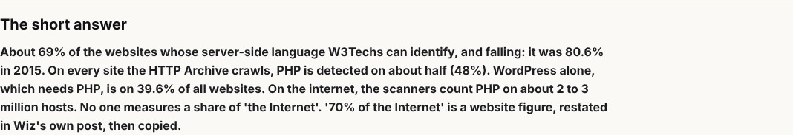
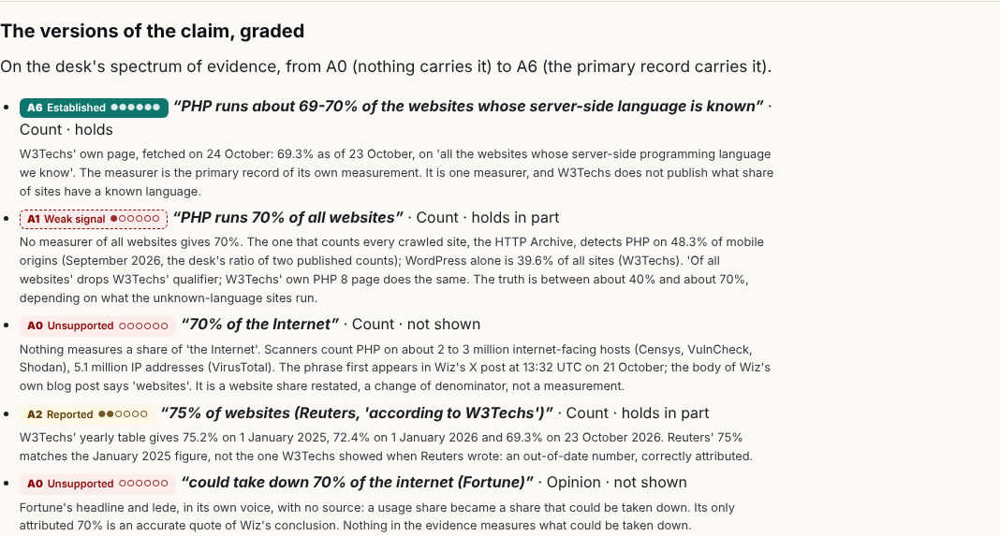
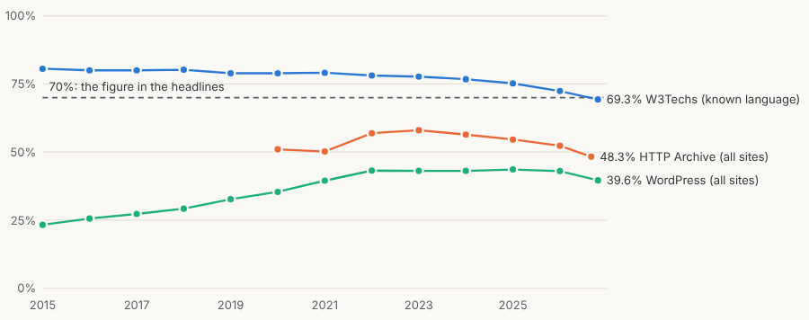
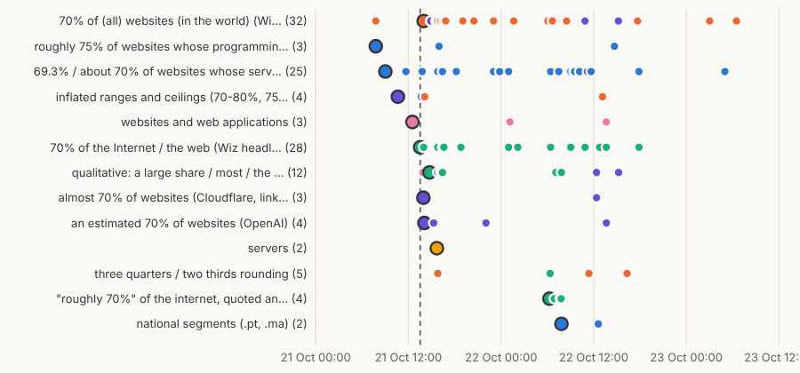
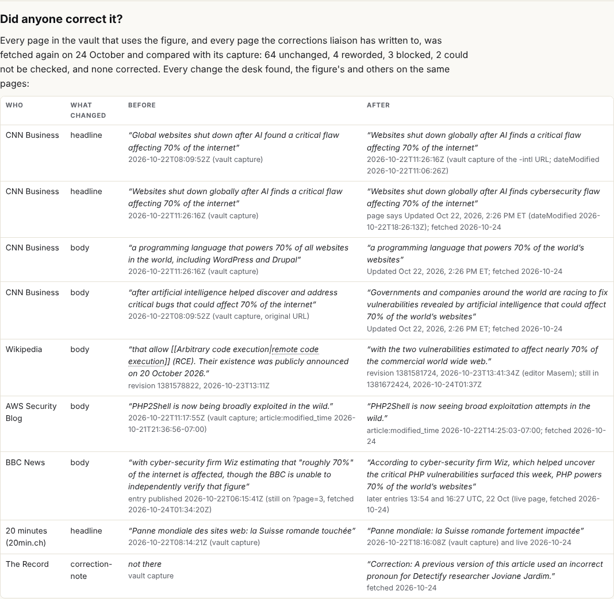
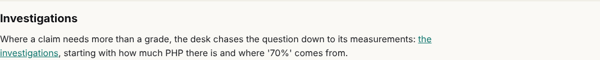

## What I was asked

The editor, in the session, on 24 October: whether the desk was running on its schedule; to pull from dev and do a pass for anything else to look at; to start a section for chasing down specific facts and mapping sets of data with their provenance; first, how much PHP there is (applications, websites, what is known), and graphs, as a detective would draw them, of the '70%' figure: its source, its methodology, every variation, the dates, and which websites changed it or corrected it. The message is recorded verbatim in `admin/content/briefs/2026-10-24__brief__factcheck-investigations-how-much-php.md`.

## What I did

- **The schedule.** The scheduled task (trig_01NJcbVPAcxf5w7N298HCbRE) last fired at 20:52 UTC on 22 October and did not fire on 23 October; its schedule had been changed at 01:13 UTC on 24 October to `CRON_TZ=Europe/London 52 8-20/4` (board 103, 238). I wrote the card the house rules ask for, `data/schedule/factcheck.json`, and set the task's prompt to the card's wording.
- **The pass (released as v0.14.4).** Took in dev (v0.13.0, 142 commits). Seven claims had changed, the news desk chief's fixes. Re-graded all seven against their captures; checked the new quotes (The Verge, PCMag, Recorded Future, Insurance Business, TPO) verbatim. Closed Finding-26, 27, 28, 33, 34, 102, 124 and 125 as fixed; K-004 and K-009 explained (K-009 by time). Finding-32 stays open. Board 212 and 244 done.
- **The investigation.** Three researchers, then an audit of their work independent of their own: 29 of 29 measures, 127 of 127 statements and 81 of 81 live excerpts re-found in the bytes whose sha256 they record. The data is in `admin/factcheck/investigations/php-share/` (case.json, measures.json, lineage.json, live.json); `fc.py export` carries it into `data/factcheck.json`; the build writes `/factcheck/investigations/` and `/factcheck/investigations/php-share/`, linked from `/factcheck/`.
- **Tickets from it.** Evidence-12 (high): AWS reworded 'PHP2Shell is now being broadly exploited in the wild.' as 'PHP2Shell is now seeing broad exploitation attempts in the wild.' without a note; this site quotes the first. Evidence-13 (CNN reworded its 70% lines twice), Evidence-14 (Wikipedia added a 70% sentence), Evidence-15 (the measurement, to capture), Contradiction-12 (Reuters' 75% is W3Techs' January 2025 figure). K-001 and K-002 updated.
- **Messages.** To the Sherpa (board 195, the Fortune analysis) and to the news desk chief (the fixes checked, Evidence-12).

## What it looks like

The short answer at the top of /factcheck/investigations/php-share/.

Five wordings of the claim on the desk's spectrum: 'about 69-70% of websites whose language is known' A6; 'of all websites' A1; 'of the Internet' A0; Reuters' 75% A2; Fortune's 'could take down' A0.

W3Techs (known-language sites) from 80.6% in 2015 to 69.3%; the HTTP Archive (all crawled sites) at 48.3%; WordPress alone at 39.6% of all sites; the dashed line is the 70% of the headlines.

127 statements in 13 wording families; colour is what each claims to measure; ringed dots are the origins; the dashed line is Wiz's X post at 13:32 UTC on 21 October.

73 page records re-fetched: 64 unchanged, 4 reworded, 3 blocked, 2 could not be checked, none corrected; the changes found, before and after.

## New features

- A reader can see how much PHP there is by each measurer, with its population, method, date and the hash of the page it was read from, and see why '70% of the Internet' is not a measurement.
- A reader can walk the lineage of the 70% figure in `<sg-graph>`, from Wiz's X post to every restatement and rewording, and see every statement on a timeline.
- Another member can read the investigation's data in `data/factcheck.json` (`investigations`), and the desk's run record and card on /team/schedule/.

## What I did not do

- The Internet Archive's history of the pages: web.archive.org was unreachable from the session (connection reset at the proxy). The history rests on the vault's repeat captures, the pages' modified dates and Wikipedia's revisions.
- HTTP Archive through BigQuery: the bq credentials are not valid in this session; the HTTP Archive's tech report API was used instead, and its shares are the desk's own division of two published counts (said on the page).
- Capturing the measurers into a vault: not the desk's scope; Evidence-15 and boards 033, 043, 222 ask the collectors.
- Board 183 (15 confirmed claims resting on one origin), 224 (the offline ledger) and 233 (one status vocabulary on every page): not reached this round.

## Policy

- `agents.py check --agent factcheck`: one write outside the append scope, `admin/build/build.py` `build_llms()`, three lines that list `factcheck/investigations/` pages in llms.txt in the same pattern every other section uses; the gate fails a page that is not in llms.txt, and the alternative (the navigation) is also outside the block. Owner of `build_llms()`: dev@php.newsroom. Named here as a policy miss.
- Pushback: board 233 asks the desk for one status vocabulary on every page; the pages are not in the desk's scope (story-site and dev own them). Answered on the row's owners, not done.
- A researcher of mine put the editor's email address in the User-Agent of one request to the Wikipedia API (rate-limited, nothing returned). It is in no file in the repository or the scratch folders. It should not have happened; later requests did not carry it.
- Injection: none seen. The gate flagged an override phrase in live.json: it was the researcher's own description of what it scanned for, not text from any page; reworded. A zero-width word joiner (U+2060) in a captured BBC title was removed and noted in live.json.

## Tasks

Closed: 212, 244, 255 (the investigation, opened and done). Still open: 004, 061, 087, 103, 183, 224, 233.

## Next

1. On the next scheduled wake: check whether Amazon's revised sentence has been captured, and re-grade amazon-honeypot and K-002 when it is (Evidence-12 is the one high item).
2. Board 183: compare the graph's single-origin 'confirmed' claims with the desk's levels; the lineage work makes this quicker.
3. Re-fetch the measures on the 08:52 wake each day, so W3Techs' share is a series and not one value.
4. The next investigation, if the editor wants one: the offline count (board 224), with the same method.
