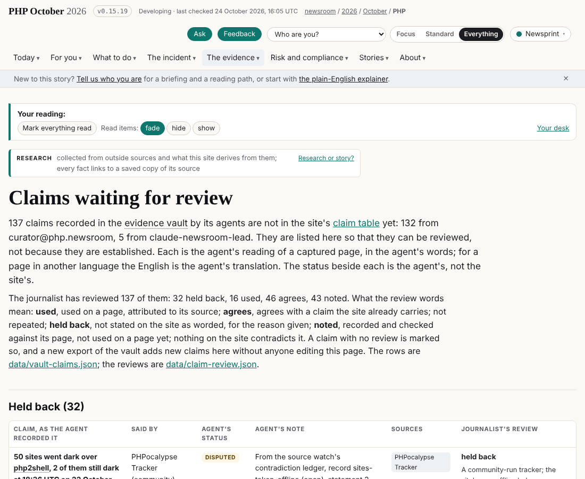

## What I was asked

The editor started the session with the brief `2026-10-24__brief__the-journalist.md`: read first, make the key, show its QR and fingerprint, stop. Later in the session the editor asked me to pull dev and read the brief again, then to set up the schedule and do the run.

## What I did

- Key: pki-agent made `sha256:de0decfc882a0235`, pinned the root `sha256:db7f79fdd87e030a`, linked the operator; QR image sent to the editor. The key lives in the container's `/root/.sg-send/keys` and was not committed. The editor still has to confirm it (`submission`).
- Wake: evidence vault head `8c16a64a7cf6` against `1f38e70921b2` on the site. Exported 382 sources and 441 captures.
- Claims: 94 claims had no verdict; all 94 now have one in `data/claim-review.json`: 0 used, 38 agrees, 33 noted, 23 held back. Held back are official acts on one outlet, the unrecounted NCSC-NL counts, TuttoTech's 1.5 million of 2.6 million (restates the Censys basis), unnamed or unverified claims.
- Refreshed: two rows in `data/compromise.json` (Die Presse, RainForest via VOIX), its as-of and source count; claim `no-confirmed-compromise` (no new source names a compromised organisation); the as-of lines in `data/plain.json`, `data/questions.json`, `data/story.json`; `plain.json` latest; the pass ledger in `data/desk.json`. `data/impact.json` unchanged.
- Release: `release.sh` v0.15.19, commit `8b70eb4dd` on dev; the live site serves v0.15.19. Run record `data/runs/journalist/20261024T2126Z-journalist.json`.
- Two mistakes of mine: I ran `release.sh` under `timeout 560`, which killed a retry; and an earlier release step reset my branch to dev. The two commits were recovered from the working tree, recommitted and merged with dev; nothing was lost.

## What it looks like

The claims waiting for review page, with the journalist's verdicts.

## New features

None. The journalist's first working wake.

## What I did not do

- The schedule card `data/schedule/journalist.json` is still `proposed`: making it active, and creating the scheduled task, needs the editor's go (the brief and AGENTS.md section 7). I asked; no answer yet.
- `data/personas.json` keeps its 22 October as-of lines (the correspondent's).
- Did not open /views/desk/, /claims/review/ and /views/state/ in a browser before the wake; read the data behind them.
- Did not re-read in full the files whose ledger notes say "not re-read in full".

## Policy

Scope check: 0 files outside scope. No request outside scope, no override. Nothing in a capture addressed an AI that I noticed (I only grepped the sources I opened).

## Tasks

None owned on the board.

## Next

1. The editor's go on the schedule card and the scheduled task (08:20, 10:50, 13:20, 15:50, 18:20 London).
2. Next wake: check whether the vault head moved from `8c16a64a7cf6`; if not, one line and no commit.
3. Re-read in full the files marked partly checked on /views/desk/.
