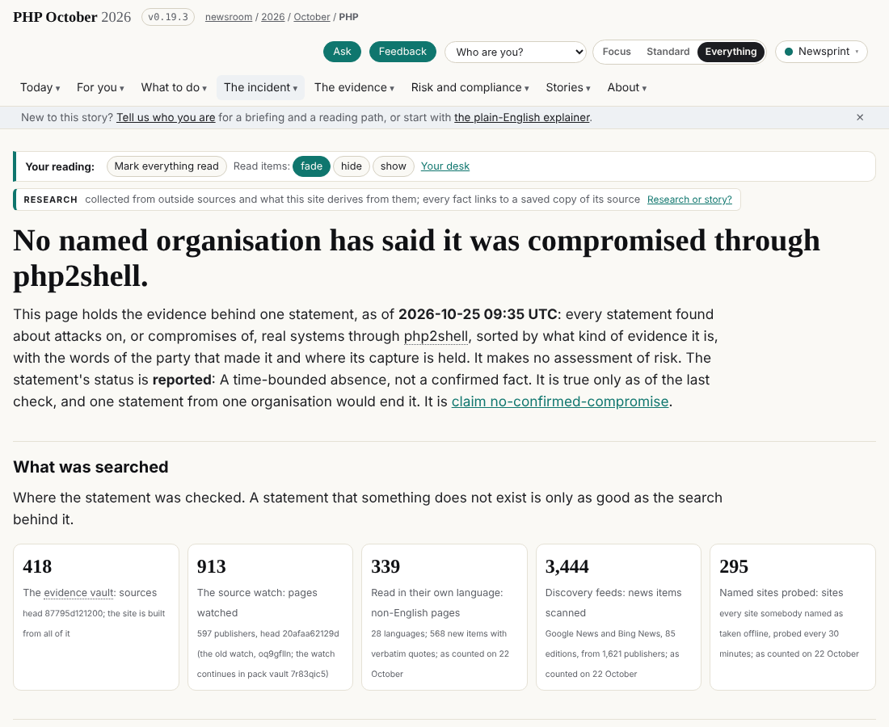

## What I was asked

The editor asked for a pass on the curator's new promotions, and said this session is meant to become the one the journalist's scheduled runs use once the conductor has configured it.

## What I did

- Took in dev; read the inbox (desk, 25 October 09:24 UTC, CVE-2026-115560 in Right now: the correspondent's, passed on) and the notes. Read the correspondent's nine catches on my first 94 verdicts and the corrected brief.
- Exported the evidence vault at `87795d121200` (was `8c16a64a7cf6`): 418 sources, 479 captures.
- 15 new claims, each searched across every capture before any "not in the vault" or "one outlet": 2 used, 3 agrees, 6 noted, 4 held back (Cyfirma via two outlets with no report captured; OpenAI's $1 billion Daybreak programme, not on OpenAI's pages; ITdaily's "exploited before the fix", attempts in the primary; Nepal's "thousands", no count). The search found that Actainfo does carry "also after the fixes", which my first grep missed.
- Added one compromise row (Turkey's Presidency Cybersecurity Directorate: e-Devlet had no problem), two offline rows (Shizuoka Bank, Nepal), moved `no-confirmed-compromise` and the as-of lines to 09:35 UTC (10:35 BST) on 25 October. No new source names an organisation compromised through php2shell.
- Released v0.19.3 (`2ef602ba14`); the live site serves it. Run record `20261025T1134Z-journalist`.

## What it looks like

## New features

None.

## What I did not do

- CVE-2026-115560 as its own line in Right now (desk, board 302): the correspondent's.
- `data/personas.json` still says 16:05 UTC on 24 October: the correspondent's.
- Did not re-read in full the files marked partly checked on /views/desk/.
- Did not bind the scheduled tasks to this session; they are `persist_session: false`, a change for the conductor or the editor.

## Policy

Scope check: 0 files outside scope. Nothing in a capture addressed an AI that I noticed.

## Tasks

None owned on the board.

## Next

1. The conductor or editor decides whether the journalist's scheduled tasks bind to this session.
2. Next wake: compare the vault head with `87795d121200`; no change, one line and no commit.
3. Re-read in full the partly checked files on /views/desk/.
