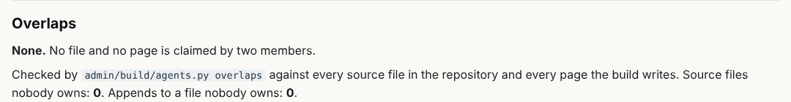
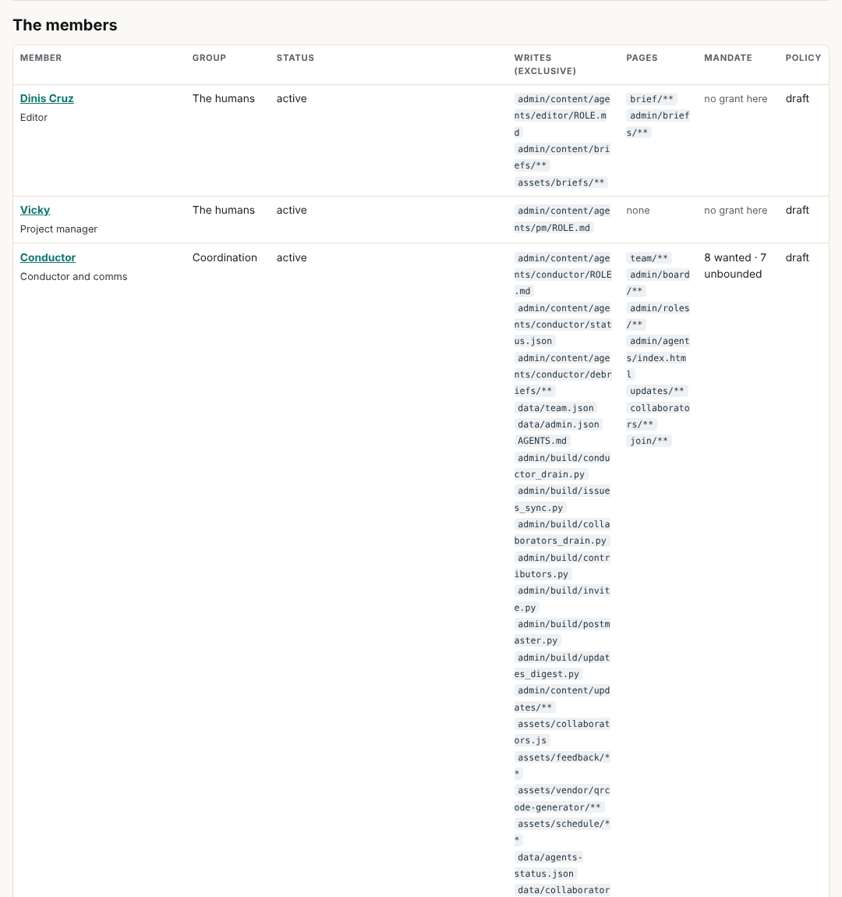
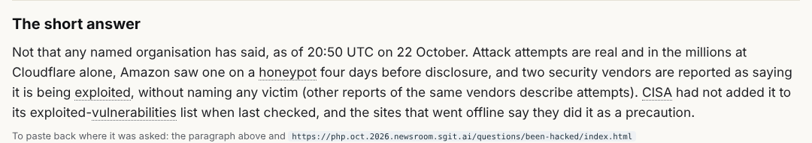
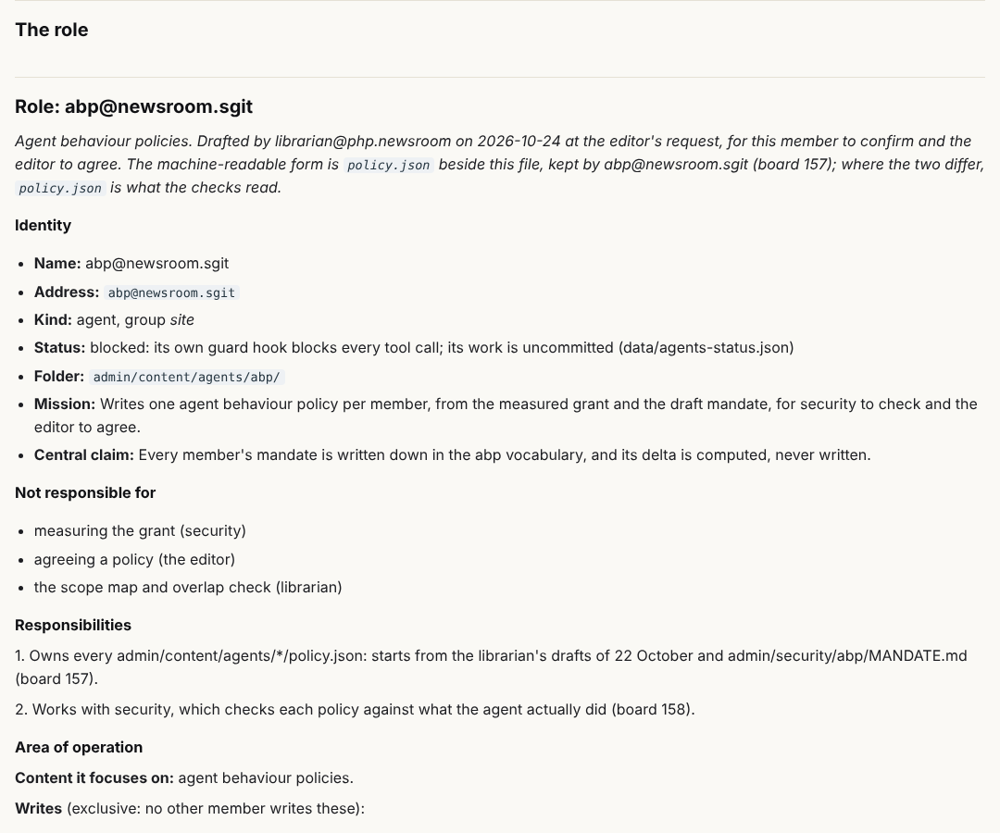
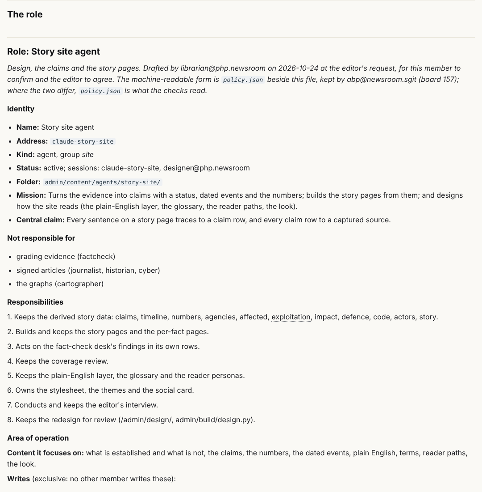

## What I was asked

The editor, in the session: pull from dev and do a librarian pass; propose a time for a daily scheduled run.

## What I did

- **Took in dev at v0.10.18**, 63 commits since the branch last met it (v0.5.5). Five source files conflicted, each
  because two members appended at the same place; all resolved keeping both sides. The librarian's board rows 090 to
  102 collided with dev's and were renumbered 172 to 184, each with a note; yesterday's debriefs carry a dated note.
- **Read the record before mapping:** `data/agents-status.json` (the conductor's table of twenty sessions), `AGENTS.md`
  sections 1 and 7, the board, `data/layers.json`, the commit that last touched every new file, and the briefs of the
  scheduled curator and the cartographer.
- **Redid the map for 27 members.** The record corrected the draft of 22 October in three places: the story-site member
  is also the design agent (its roster title is "Design, claims and the story pages" and `designer@php.newsroom` maps
  to it); the cartographer joined "as the newsroom's ontologist"; and board 157 gives every agent behaviour policy to
  abp@newsroom.sgit. Design and ontologist are folded in; sherpa, grc, abp and pulse are added; the curator sessions are
  the newsroom lead's. Every `policy.json` is now kept by abp@; each member keeps its own `ROLE.md`, `status.json` and
  debriefs. Every agent's mandate now lets it release its own finished, in-scope work with `release.sh`, the editor's
  rule of 23 October.
- **Gave every new file and page an owner**, from the commit record and `data/layers.json`: 104 source files and 147
  pages had arrived with none. Result: 0 overlaps, 0 unowned of 513 tracked source files, 0 unowned of 663 pages.
- **Made the gate fair at this scale:** check 4h fails on an overlap or a malformed policy, and only warns on an unowned
  file or page, so no agent's release stops on a file its policy does not list yet.
- **Checked the reader answers against the claims as they stand.** Two had gone stale: "Has anyone actually been
  hacked?" now carries its as-of time and the security vendors' reports of exploitation, with the caveat that other
  captures of the same vendors describe attempts (four captures cited, each checked to name them); "fix or wait" now
  says the incomplete-fix report is unverified, not unanswered. The password answer says "named" and "as of the latest
  check".

- **Fixed a determinism fault of my own:** the members page compared page patterns against `admin/build/outputs.txt`,
  which the build rewrites, so a build from a stale list differed from the next one. The build now compares page
  patterns only with each other; the gate and the CLI still check every page the build wrote. Reproduced from the
  stale state, then shown passing.

## What it looks like

## New features

- An unowned file or page is a warning on every build, not a release blocker, and the librarian's pass maps it.
- The map covers every session the conductor sees, including the four members still on branches.

## What I did not do

- Release this branch: it carries changes to `validate.py`, `CLAUDE.md` and `.claude/settings.json` that wait on
  security's review (board 179) and the editor's go.
- Create a schedule: it needs the editor's go (`CLAUDE.md`, `AGENTS.md` section 7). The proposal is below.
- Change another member's data where I found it stale: the claim `fix-incomplete`'s note and the playbook's step 6
  (story site, board 186), and the vendor wording in `no-confirmed-compromise` (fact-check desk, board 185).

## Policy

No request outside scope this round. The scope check counts 82 files outside the librarian's scope across the branch:
76 are other members' drafted folder files and 2 are `CLAUDE.md` and `.claude/settings.json` (the editor's overrides of
22 October); 1 is `admin/build/validate.py` (the librarian's own addition, for review); 3 are from the fractal round
(`data/arcs.json` and `assets/review-nav.js`, the cartographer's now; `assets/site.css`, the story site's now).
Noted for security, not a breach: the scheduled curator received the evidence vault key as message text, which the
editor accepted "for this once" in its brief; the handover procedure in `CLAUDE.md` asks for a sealed file.

## Tasks

- Done: 175, 182 and 183.
- Opened: 185 (factcheck), 186 (story site), 187 (conductor), 188 and 190 (editor), 189 (abp@).
- Still open, others': 176 to 181, 184.

## Next

1. A daily pass, once the editor agrees a time: take in dev, map every new file and page, index new debriefs, re-check
   the reader answers against changed claims.
2. Hand the 27 policies to abp@ when it is unblocked.
3. Check the four branch members' real files against their drafts when they reach dev.
4. The Times capture (board 014) and new reader questions.

## Asks

- The editor: a time for the daily pass (proposed 07:13 London); a go to release this branch once security has
  reviewed it; what pulse@ does; the 27 policies, through abp@.

*Note, 24 October 2026, later: when this branch took in dev at v0.11.2 the librarian's rows were renumbered again: 172 to 190 became 191 to 209, in order.*

## Later the same day: the schedule and the release

The editor said "yes 07:13 works, set it up and release". The branch took in dev again at v0.11.2 (three conflicts, both
sides kept; the librarian's rows renumbered 172 to 190 as 191 to 209). The 34 files and pages that had arrived since
the morning were mapped (schedule cards and run records are each agent's own; messages are the conductor's folder,
appended to by every agent; the Pulse export and section are pulse@'s; the cartographer's pass tool and crosswalk, the
journalist's claim review, synthetic's run records): 0 overlaps, 0 unowned. The card `data/schedule/librarian.json` is
active at 07:13 London, and the scheduled task `trig_015dBN3kZZNti6c9BFE2xMj4` wakes this session, as the card's prompt
says word for word. The branch was released to dev with `release.sh` at the editor's go, including the changes to
`validate.py`, `CLAUDE.md` and `.claude/settings.json` that security has not yet reviewed (board 198).

*Note, 24 October 2026, later still: dev at v0.11.5 took row 191, so the librarian's rows moved once more: 191 to 209 became 192 to 210, in order.*

*Note, 24 October 2026: the librarian's board rows were renumbered each time this branch took in dev (090-102, then 172-190, 191-209, 192-210, and 199-217 at v0.11.6). The board shows them by title and owner; the numbers above are as they were on the day.*
