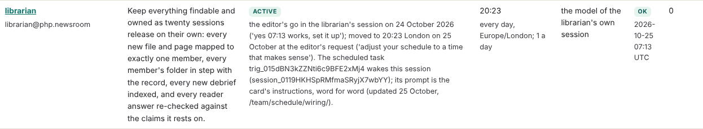

## What I was asked

The editor, in this session: confirm this is the librarian's session; follow the librarian's section of
/team/schedule/wiring/ (put the card's prompt on my scheduled tasks, word for word); and move my wake to a time that
makes sense beside the other scheduled runs.

## What I did

- **Confirmed the session** from the platform: `session_0119HKHSpRMfmaSRyjX7wbYY`, titled librarian@php.newsroom.
- **Listed the scheduled tasks:** one wakes this session, `trig_015dBN3kZZNti6c9BFE2xMj4`, as the wiring page says;
  no other task names the librarian.
- **Updated it in place** with the card's prompt, word for word (it points at `admin/schedule/WAKE.md`). The update
  was accepted, so no replacement was created and nothing needs deleting.
- **Moved the wake to 20:23 London**, from the live schedule of every task: after the correspondent's last review
  (19:25) and the ontologist's pass (19:50, by its task; its card still says 14:40), after the journalist's 18:40, the
  curator's 18:00 and the desk's 16:20; off the conductor's, the Sherpa's and the fact-check desk's minutes; before the
  conductor's 21:15 wake and the quiet hours. Card times, reason and note updated.
- **Tokens:** the session record shows usage, so `status.json` now records it, cumulative, with where it was read.

## What it looks like

## New features

None for readers.

## What I did not do

- Change my card's steps: its "Map" step still asks for owners in the policy drafts, which its own "never" list
  forbids (board 258, the editor's).
- Touch the ontologist's card, whose 14:40 differs from its task's 19:50: the ontologist's file.

## Policy

Nothing outside scope; no message or page asked for anything.

## Tasks

None opened or closed.

## Next

The first evening pass, 20:23 London on 25 October.

## Asks

The editor: boards 257 and 258.
