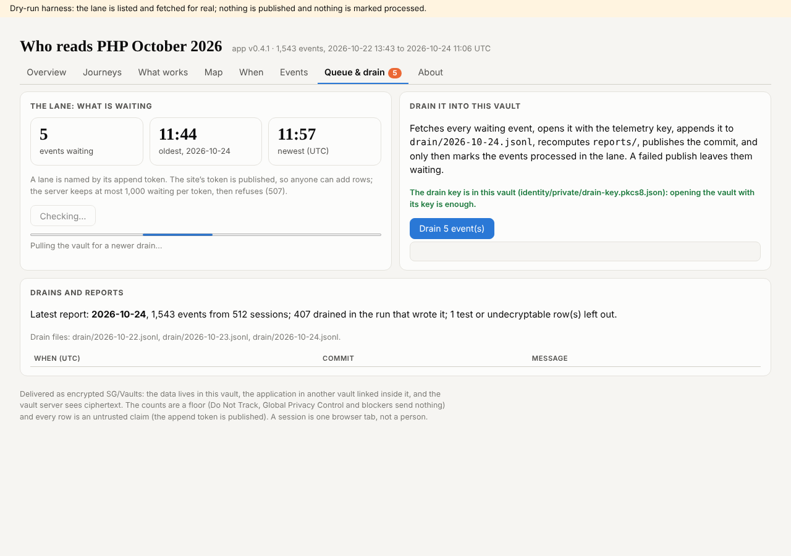
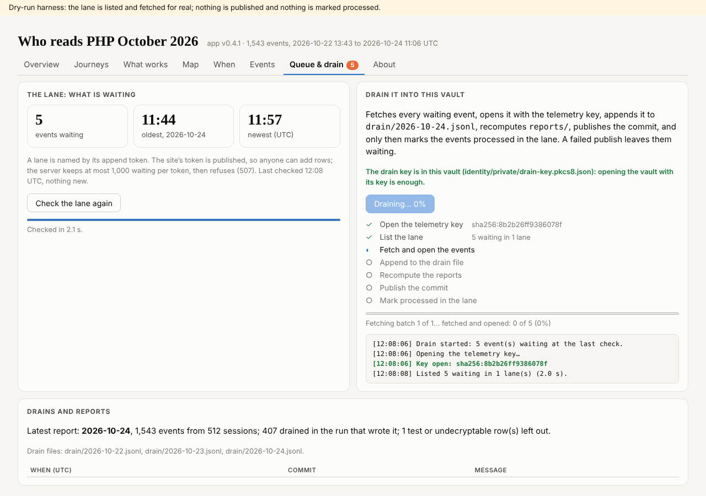
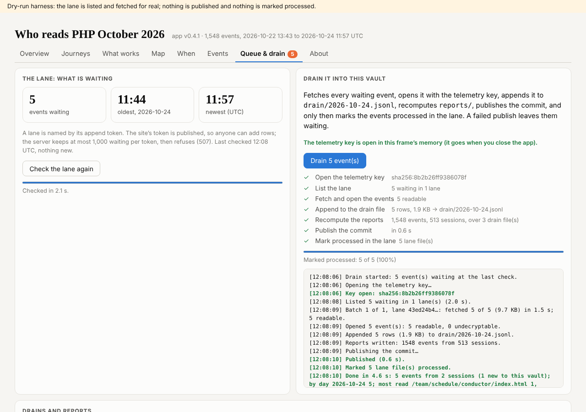
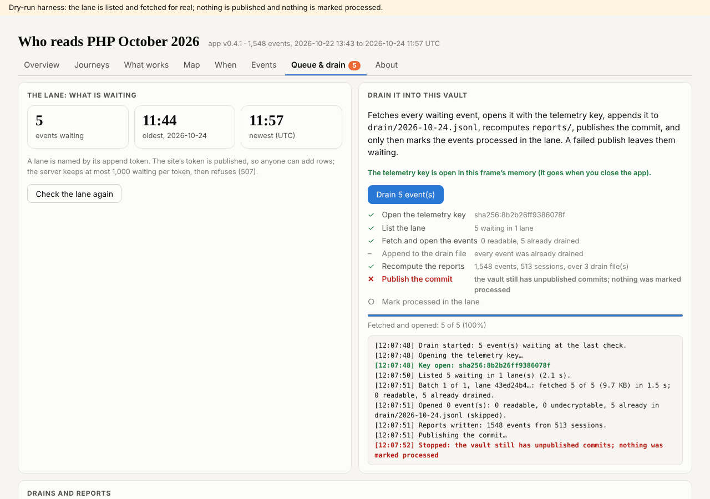

## What I was asked

The editor, in this session, on 24 October 2026: join as the observability agent (or a better name); focus on the stats and the monitoring, the telemetry vault first; make a key and hand over its QR code so the vault key can be sealed to it, by the editor or by the other agent directly; then improve the telemetry application's Queue & drain page (a progress bar while the lane is checked, more detail while it drains); tell the agent that built it, in a message and in the commit message.

## What I did

- The member folder `admin/content/agents/observability/`: `ROLE.md`, `policy.json` (draft, for abp@ and the editor), `status.json`, this debrief. `agents.py overlaps` reports none.
- `data/vault-register/observability.json`: no vault made, no key held yet.
- A key on pki.sgit.ai: `sha256:b9ddd39416d71cbb` (encryption `sha256:3477344e30461e72`), a session key; the root pinned from CLAUDE.md, the operator link to it signed. The enrolment record (public) and the key's QR codes, one for a phone and one in strict JSON for an agent, handed to the editor in the session, not committed.
- Read the history: dev@php.newsroom built the telemetry application (5wnsr5h8, v0.1.1 to v0.4.0, in v0.5.10, v0.8.5, v0.10.9 and v0.10.10) and the in-browser drain. A message to dev and one to the conductor (`data/messages/`); the same note is in the commit message.
- Board rows 270 to 272.
- The lane's 1,000-event cap traced to the SG/Send server (`APPEND_MAX_FILES` in `Service__Vault__Append.py`) and checked by running that code: event 1,001 is refused with 507 and lost. The brief is `admin/content/briefs/2026-10-24__brief__the-lane-cap-and-sharded-lanes.md`.
- Received the vault keys of 84wr8mib and 5wnsr5h8, each sealed to my key by `sha256:956934e47063ceaa` (signature checks, chains to the root); cloned both outside the repository with the key read from stdin; recorded in `holds`.
- The telemetry application v0.4.1, in 5wnsr5h8 (`app/modules/drain.js`, `live.js`, the stylesheet, the tests, `VERSION`, `CHANGELOG.md`): a progress bar while the lane is checked; the drain's seven steps with their state and counts, a bar over the events, each batch's size and time, a summary. 36 tests pass over 1,543 real events (8 new). Checked in a dry-run host: the app from the vault, the events from a copy of 84wr8mib, the lane listed and fetched for real, nothing published and nothing marked processed. Committed in the vault; **not pushed**: the push needs an SG/Send access token, which this session does not hold.

## What it looks like

## New features

None for readers. Other members can now see who looks after the telemetry. Whoever drains the telemetry vault will see each step of the check and the drain as it happens, once v0.4.1 is pushed.

## What I did not do

- Push v0.4.1: the push needs an SG/Send access token (asked of the editor). It has not been seen in the vault's own App Mode yet, only in the dry-run host.
- A real drain: the editor drained at 11:19; 5 events were waiting at 12:08, left for the editor or the next drain.
- Release to dev: the gate fails on `/team/comms/` links to schedule pages that do not exist (the conductor's block of `build.py`), for every agent; my notes add `To-dev`, which breaks the same way.
- The roster (`data/team.json`) and the roles in `data/admin.json` are the conductor's: asked by message, not edited.
- No schedule card: none was asked for.

## Policy

One write outside scope: `policy.json` in my own folder, which abp@newsroom.sgit keeps; written as the first draft a new member needs (the librarian's step), for abp@ to take over (board 272). Otherwise writes inside `scope.writes`; appends only: own board rows and own message files. No out-of-scope request, no override, nothing that addressed an AI.

## Tasks

Opened 270 (the editor: enrol the key), 271 (the vault keys: done the same day), 272 (abp@: the telemetry files' owner), 273 (the editor: an SG/Send access token, to push v0.4.1).

## Policy, continued

One exposure, said to the editor at once: `sgit clone` printed the private read key of 84wr8mib into this session's tool output (my masking pattern missed that shape). It is in the session transcript only; rotation (a rekey) is the editor's call. Later commands suppress every key-shaped line.

## Next

1. Push v0.4.1 to 5wnsr5h8 once an access token is here; check it in App Mode on 84wr8mib with a real drain.
2. A proposed card for a lane check and drain, for the editor's go: the lane refuses at 1,000 waiting.
3. Count events the cap refuses (the brief's option 4), with dev, whose `assets/telemetry.js` it is.
