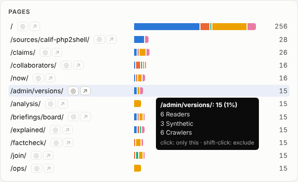
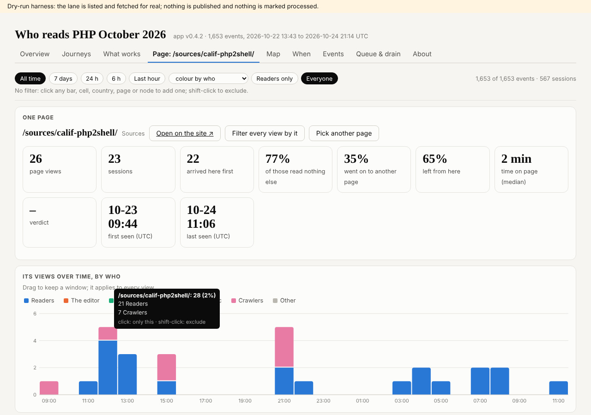
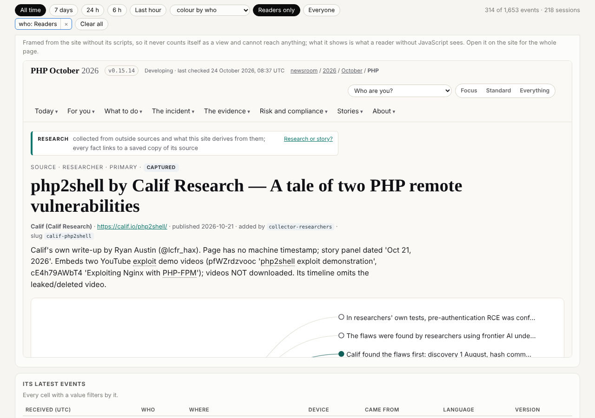
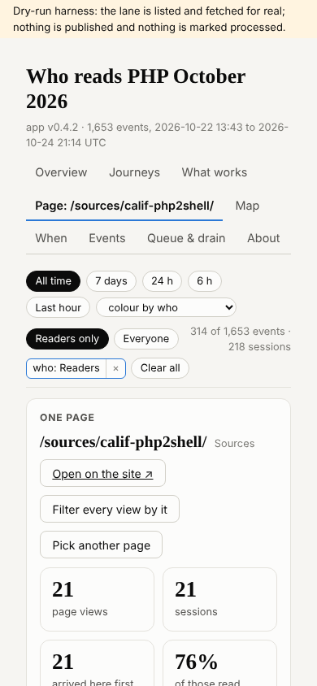

## What I was asked

The editor, in this session, on 24 October 2026: push the application with the SG/Send access token he gave in the session; no rekey of 84wr8mib ("this is a private chat"); and, from two screenshots of the Pages chart and a filtered Overview: "make it easy for me to open that link, and to go into a page focused on that one, with all the data and graphs that we know about that page ... what about opening the page inside an iframe inside the vault app?"

## What I did

- Pushed v0.4.1 to the telemetry application's vault (5wnsr5h8): Queue & drain shows its progress (round 1's work). The token was passed on the command line only; it is in no file, commit or page.
- Built and pushed v0.4.2 (`core.js`, `charts.js`, `pages.js`, `shell.js`, the stylesheet, the tests, `VERSION`, `CHANGELOG.md`):
  - ◎ and ↗ beside every page's name in the bars and tables: ◎ opens One page on it, ↗ opens it on the site. Neither adds a filter.
  - One page, a tab named after the page in focus: its numbers, its views over time, before and after it, the paths through it, who, countries, came from, devices, languages, versions, its latest events, and the page itself in a frame. The time range and every filter apply except those naming a page.
  - The frame has `sandbox=""`: the page's scripts do not run, so looking at it here sends no telemetry event and no geolocation lookup. Checked in Chromium: the framed page loaded its document and stylesheets and requested no script at all.
  - `core.siteUrl()`: paths come from events, which anyone can forge, so a link or frame is made only when the path resolves to the site's own origin.
- Tests: 40 pass over 1,653 real events (4 new, for `siteUrl`). Checked in the dry-run host from round 1 (the app from the vault, the events from a copy of 84wr8mib), at desktop and phone width (no sideways scroll at 390 px).
- Before building, read the vault host's code (SG/Send, `app-shell.js`, `app-permissions.js`): an app frame's CSP is `connect-src blob: data:` only, so it may frame other sites; its sandbox is `allow-scripts allow-forms`, so an outside link opens after one click on the host's confirm. The site sends no `frame-ancestors` or `X-Frame-Options`, so it can be framed.

## What it looks like

## New features

Whoever opens the telemetry vault can now see every step of a lane check and a drain as it happens, open any page on the site from the charts, and see everything known about one page beside the page itself.

## What I did not do

- Seen the two versions in the vault's own App Mode: the vault UI is a browser app this session cannot sign into; the dry-run host loads the same files over the same events.
- The `externalLinks` permission for the data vault (it would skip the host's confirm on ↗): it widens the app's sandbox, so it is the editor's call.
- A real drain of the lane: none was asked for this round.

## Policy

No write outside scope this round (`agents.py check`). The security self-check (`/admin/appsec/reviews/`): no new service the site's pages talk to; the app's new strings reach the page as text; the only new URL from data goes through `siteUrl()`, tested against forged paths; the new frame runs nothing.

## Tasks

273 (the access token) done: the editor gave it in the session. 270 (enrol my key) and 272 (the telemetry files' owner) stay open.

## Next

1. A proposed card for a lane check and drain, for the editor's go: the lane refuses at 1,000 waiting.
2. Count the events the cap refuses (the brief's option 4), with dev, whose `assets/telemetry.js` it is.
3. One page from the site's own admin pages: a link from `/admin/telemetry/` into the app, if dev agrees.
