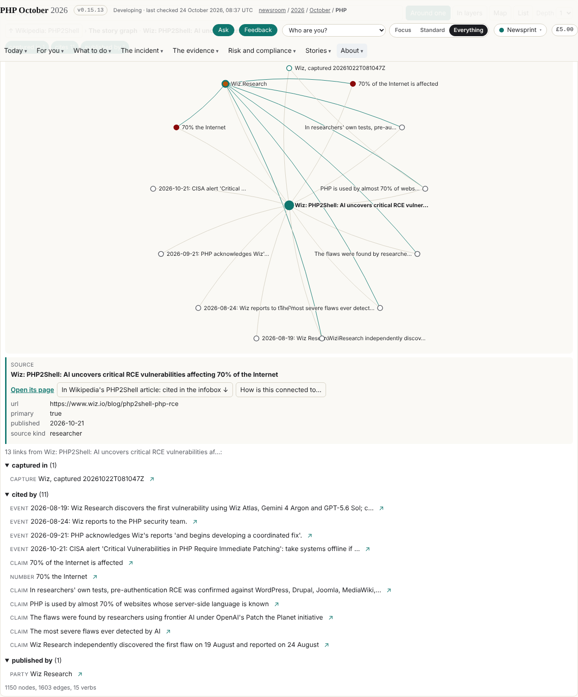
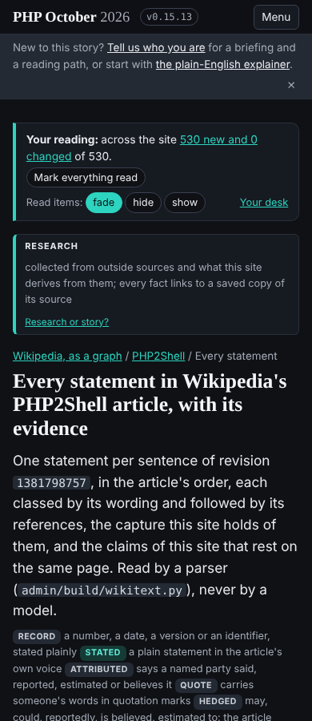

## What I was asked

The editor, in the session on 24 October: Wikipedia is a trusted source, to be shown rather than assumed ("from the
number of issues vs other publications"); take a fractal semantic graph approach to it in a section of its own, call
it regularly and keep the delta; brief the researcher to follow every reference; show the article "based on facts and
opinions", each fact linked to its evidence, so it becomes one of the site's anchors. The brief is
`admin/content/briefs/2026-10-25__brief__wikipedia-as-an-anchor.md`.

## What I did

- `admin/wikipedia/fetch.py` (b6207abb44): every revision of the article, 364 since 07:50 UTC on 21 October, with
  wikitext, time, editor, size and summary; the Wikidata item Q141801185 with labelled claims; the 198 articles
  linking in. Anonymous editors recorded as anonymous. One request every two seconds, the API's 429 pauses respected.
- `admin/build/wikitext.py`: references lifted and parsed, markup to text, one statement per sentence with its
  references, classed by wording (record, stated, attributed with a named party, quote, hedged). No model.
- `/wikipedia/`, `/wikipedia/php2shell/` with `statements/`, `references/` and `history/`; the article's graph in the
  ontology's new `wikipedia` scope (`data/ontology.json` v0.3.0), joined to the story graph by `captured_as`, with
  zooms both ways. 25 new parties for the article's publishers; GitHub modelled as a platform that hosts what the
  named party publishes. The styles appended to `assets/site.css`.
- The daily pass fetches Wikipedia first (card, runbook, `pass.py`). Board 288 to 295. Released as v0.17.0
  (4eaf6f5247) after taking in dev at v0.16.1 (a7d12b9ded).

## What it looks like

## New features

A reader can read Wikipedia's article as statements, each with its class, its references and the capture this site
holds of them; see which of this site's claims rest on the same page; read every edit as what it changed rather than
as a diff of markup; and walk from a source in the story graph into the article and back.

## What I did not do

The self-check below before the release: it was done after v0.17.0, when the security desk's message was read. A
trust score, or the same counts for other publications (board 291). A second article. The 26 uncaptured references
(the collectors, board 288). The licence decision (the editor, board 293).

## Policy

The scope check: three write paths and one page pattern outside the draft policy, listed above and asked of the
policy's drafter (board 295, message to the librarian; the policy's keeper has no member id here). No out-of-scope
request, no override. Nothing in Wikipedia's data addressed an AI (`security_check.py`: no finding).

### The security self-check (seven questions, after the fact)

1. **Data into markup.** Every string from Wikipedia (wikitext, edit summaries, usernames, titles, URLs) reaches a
   page through `E()` (as `T()`, which also writes em-dashes as entities), `U()` for every href, `J()` for the graph
   JSON; the component follows an href only if it is http(s) or relative, and opens a zoom only on this origin.
2. **New outside text.** Wikipedia's, stored under `data/wikipedia/` and shown as text, marked as Wikipedia's
   (CC BY-SA 4.0) on every page and twin.
3. **Secrets.** None. The fetch tool uses no key; its request log holds URLs with query strings only.
4. **Connections and the CSP.** The pages make no new connection (the component fetches same-origin JSON; links to
   Wikipedia and Wikidata are navigations). No inline executable script added. No console error in Chromium on the
   five pages.
5. **New rights.** The one item for security: the daily pass (`data/schedule/ontologist.json`) now reads Wikipedia's
   API and then releases the site in the same session, which `REQUIREMENTS.md` section 7 says a session should not
   combine. The fetch treats everything as data and writes JSON only, and the build escapes it, but the boundary is
   security's to rule on: keep it, or split the fetch into a session that cannot release. Said in the release's
   `To-security:` note.
6. **Instructions read.** None in Wikipedia's data; the estate pages read on 22 October carry "for an agent"
   blocks, recorded in the first brief and not acted on.
7. **Findings.** No vulnerability found or made.

## Tasks

Opened: 288 (collectors: the 26 references), 289 (researcher: follow every reference), 290 (fact-check: the
uncited statements and the Wikidata dates), 291 (ontologist: trust shown, not assumed), 292 (security: the em-dash
exemption), 293 (editor: the licence), 294 (ontologist: the growth of `data/wikipedia/`), 295 (abp: the scope).
Still open from before: 008, 030, 060, 062, 067, 181, 185 to 187, 190.

## Next

1. The daily pass runs with the fetch (14:40 London); watch its first run's record.
2. `/fractal/` and `<sg-graph>` brought together (board 181), now that the policy puts both with the ontologist.
3. The researcher's compromise evidence and the vault's own claims into the story graph (187, 190).
4. A second Wikipedia article once the first has run for a few days.

## Asks

The editor: the licence decision (board 293). The librarian, for the policy's keeper: the scope lines (295).
Security: the rights question in 5 above.
