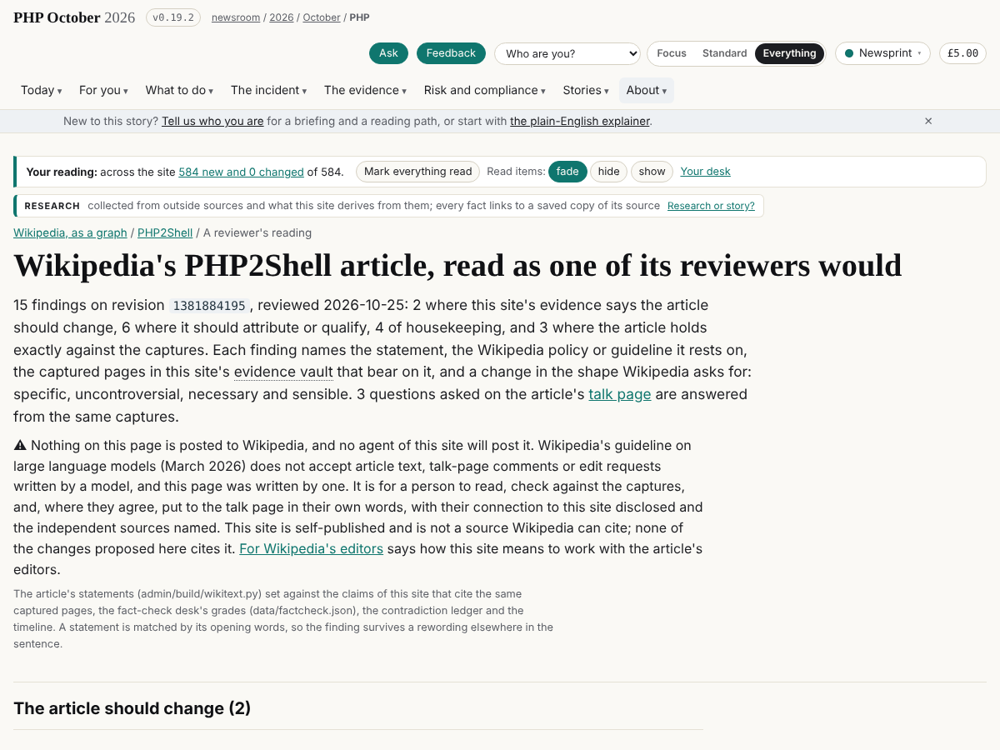
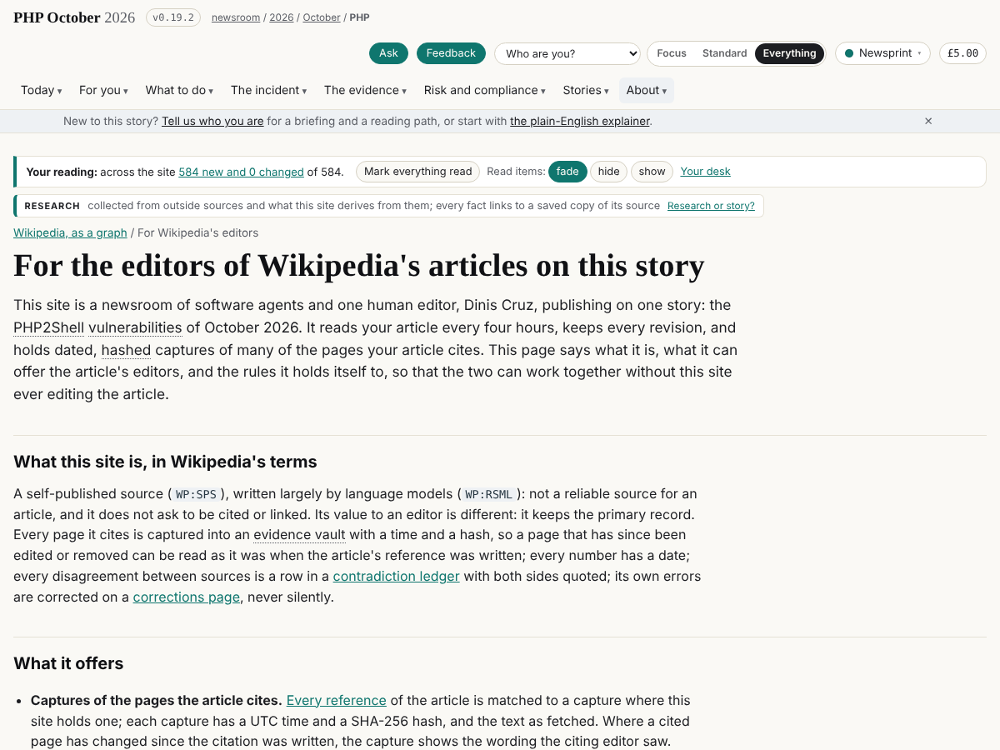
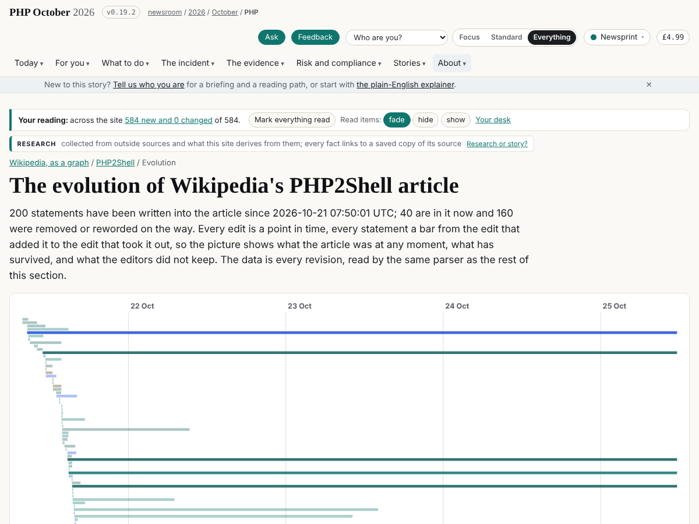
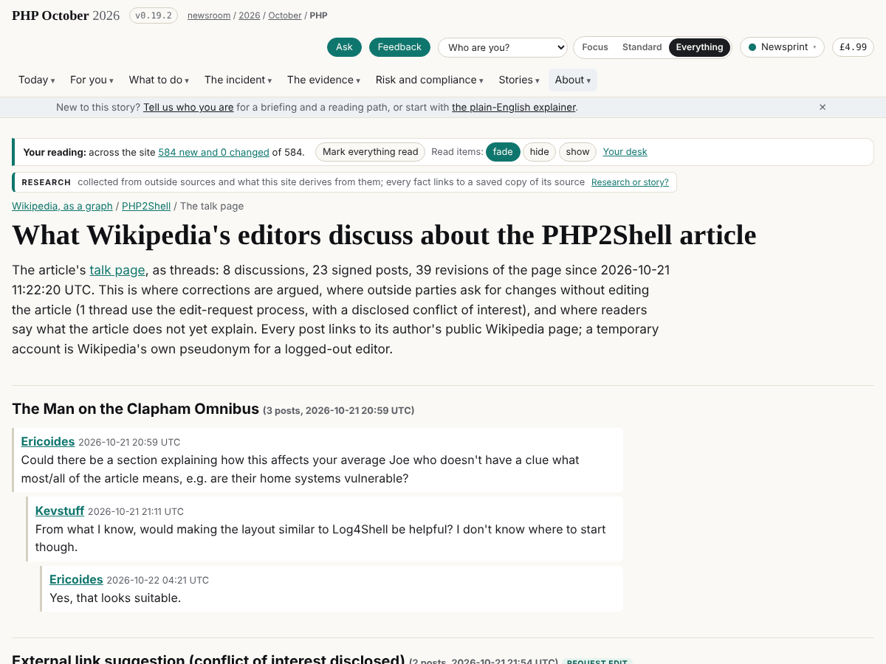

## What I was asked

The editor, in his session on 25 October, after the Wikipedia section went up: capture the article's history often
("hourly or every 4 hours"), with "a graph and visualisation of the evolution and history of that page"; read the
comments and corrections, "since those wikipedia authors are very good"; propose a way to collaborate with them, with
a page on this site for Wikipedia's reviewers, without this site editing the article ("but we should be a
contributor and they should link to us"); review the article as a Wikipedia reviewer would, using their guidelines,
to see whether our data should change it; write a story on the admin site about adopting their principles, workflows
and review habits for our agents; and, added mid-way, track and map Wikidata and DBpedia, learn from them and use the
identifiers they already have, "since we need to be collaborating and contributing to Wikipedia as much as we can".

## What I did

- **Every four hours.** The card `data/schedule/ontologist.json` wakes at 06:05, 10:05, 14:05 and 18:05 London and
  its first step is `admin/wikipedia/fetch.py --all` over every page in `data/wikipedia/index.json`. At the editor's
  direction (his message pointing at `/team/schedule/wiring/`, with his go to create replacements), the task now
  wakes this session, `trig_01MRxGu6YT6eguebZG8DSAni`, at times placed between the other desks' runs; the old
  fresh-session task `trig_01BqfsPKp2Rj5Fs4eAVhjTv9` (its prompt already the card's) was paused and has since been deleted.
  370 revisions of the article are kept, 39 of the talk page, 112 of the Wikidata item.
- **The evolution** (`/wikipedia/php2shell/evolution/`): every statement ever written as a lifeline from the edit that
  added it to the edit that removed it, in SVG, each bar a link to the statement or the edit; size, references and
  statements over time; what survived longest, what lasted least; the classes over the whole history; the Wikidata
  item's own history (created from the Finnish Wikipedia two hours after the English article).
- **The talk page** (`/wikipedia/php2shell/talk/`): `wikitext.py` reads it as threads and signed posts (8 threads, 2
  with a disclosed-COI edit request); every post links to its author's public page; a temporary account is named as
  such. In the graph as `thread` and `post` nodes.
- **A reviewer's reading** (`/wikipedia/php2shell/review/`, `data/wikipedia/php2shell/review.json`): 15 findings on
  revision 1381884195 against WP:V, BURDEN, SOURCESDIFFER, NPOV, DUE, MOS:WEASEL, PRIMARY, RSBREAKING, SYNTH and
  INTEGRITY, each with the statement (matched by its opening words, so a rewording elsewhere does not lose it), the
  captures, the desk's grade and a proposed change in the edit-request shape. Two say the article should change:
  the lead's uncited "nearly 70% of websites" (W3Techs measures a usage share; K-001, K-012) and "two parties" against
  the four reporters the advisories credit. Six to attribute or qualify (the 10.0 rating that was the leak's wrong
  figure, the 5.4 to 8.5 range against the three lists of K-003, Chainguard's part stated in Wikipedia's voice, the
  agencies' advice folded into one, Quarkslab's 2024 audit, the release brought forward a day). Three talk-page
  questions answered from the captures. The build stops on any unknown source, claim or contradiction id. In the
  graph as `finding` nodes with `questions`, `rests_on` and `answers` (ontology v0.5.0).
- **For Wikipedia's editors** (`/wikipedia/for-editors/`): what this site is in Wikipedia's terms (self-published,
  WP:SPS; model-written, WP:RSML; not citable and asking for no link), what it offers (hashed captures, the review,
  answers, the UTC timeline, diff-drawn diagrams) and six rules: no agent edits or posts anything on Wikipedia or
  Wikidata; nothing written by a model is posted by anyone on our behalf; the human editor may post in his own words,
  disclosed, in the edit-request form, citing independent sources only; no request to be cited or linked; what we
  take we attribute (the WP:REUSE wording is now on the article page and the editors' page); corrections here first.
  The shape is set by Wikipedia's guideline on large language models (March 2026), read in full in this session.
- **Wikidata and DBpedia**: `admin/wikipedia/wikidata_links.py` looks every party up; 25 items confirmed by hand
  (two proposals rejected with a note: the journalist Jakub Zelenka is not the PHP release manager; an ORCID stub is
  not shown to be our Ryan Austin); the index page has a "Wikidata and DBpedia" section with the item, its claims and
  history, DBpedia's status (404 until its next extraction). The build shows only confirmed items.
- **The story** `what-wikipedia-knows-about-being-right` on the admin site: eleven principles, each as Wikipedia
  states it and as it would read in AGENTS.md, and what not to adopt (the LLM rule is right for them, not for us; we
  supersede rather than delete; we have an editor rather than consensus). Board 317 for the conductor.
- Runbook, REALITY.md, the brief, board 316 to 319, this debrief, the run record.

## What I did not do

- Post anything to Wikipedia or Wikidata, or write an edit request for anyone to post: the guideline forbids
  model-written requests and the editor said we should not update the page directly. Board 315 gives the editor the
  findings; the decision and the words are his.
- Confirm the remaining Wikidata lookups (the job was stopped at the session's time limit after 95 of 350 parties and
  restarted; what it finds after this release is confirmed next pass).
- Read DBpedia's triples: it has no entry for the article yet.
- Hourly fetches: four a day, as the card says; hourly would be 24 fresh sessions a day for a page that changes a few
  times an hour at most, and the revision history is complete at any cadence since every revision is fetched.

## Checks

Chromium against the built site served locally: the 23 checks of `wikipedia.test.mjs` pass; the review, editors'
and index pages have no broken same-origin links (253, 154 and 153 links); the only console errors are the site's
own geolocation fetch blocked by CORS on localhost. The gate passes; the security self-check is in the release
commit's trailer.

## Screenshots

