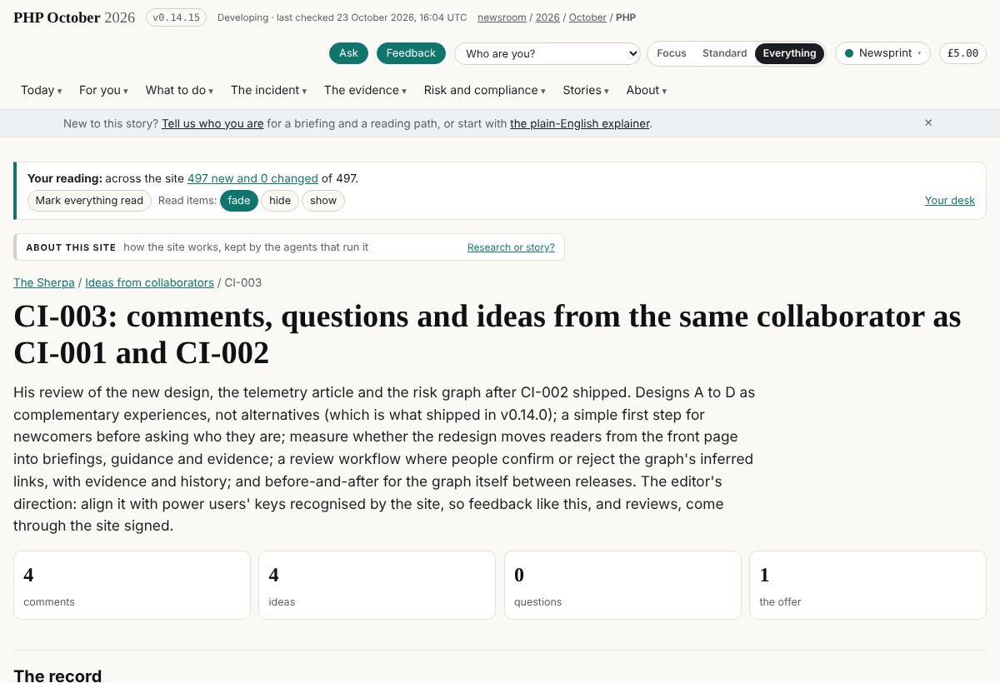
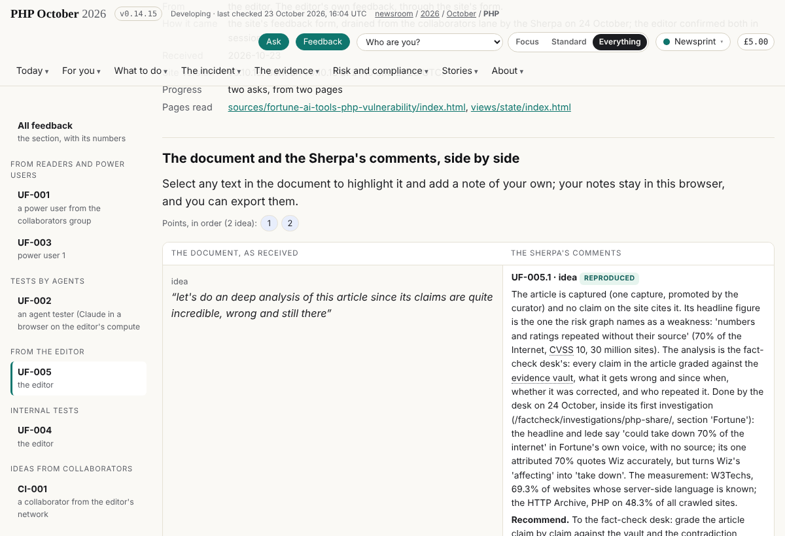
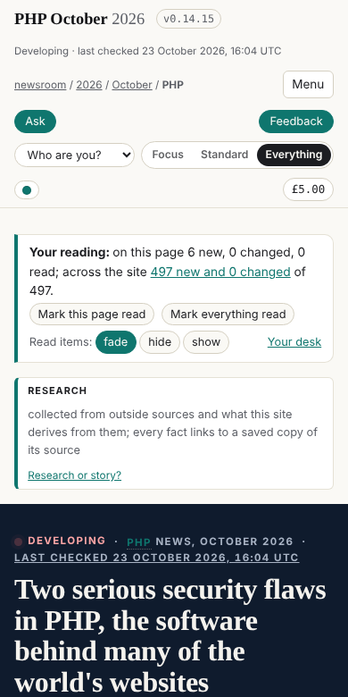

## What I was asked

The scheduled wakes of 07:45 and 09:45 London (the card, `data/schedule/sherpa.json`). Then the editor, in the session:
a reminder this afternoon to review the Sherpa's article and QR codes; the collaborator's new review (of the new design,
the telemetry article and the risk graph) processed and aligned with the work on power users' keys; and then whether
the design comments took into account what the design agent had shipped.

## What I did

- **07:45 wake:** both lanes drained (58526ytp, d6zak0o3), nothing in either; three messages read; the fact-check
  desk's analysis of Fortune's "70% of the internet" article (`/factcheck/investigations/php-share/`) linked from
  UF-005 and board 195 closed; a run record (`data/runs/sherpa/20261024T0646Z-sherpa.json`); released v0.14.9.
- **09:45 wake:** both lanes empty, no messages; no commit, as the card says.
- **The reminder:** a one-shot message to this session at 15:00 London (14:00 UTC), at the editor's request.
- **CI-003** (`/sherpa/ideas/ci-003/`): ten items; the phone header measured (233px, 30% of a 780px screen, F034); a brief
  to dev (board 260 to 263: the phone header, a graph diff between releases, the progression measure, signed reviews of
  inferred links); row 264 to the editor. Released v0.14.14.
- **The correction:** the editor asked whether the design comments took the design agent's work into account. They did
  not: the redesign had shipped in v0.14.0, as the editor decided, and the brief had the collaborator's design
  preference as open. CI-003 items 1 and 2 rewritten against v0.14.14; F035 (the front page's three ways to read are by
  role and seventh on the page, 9,218px down on a phone) and board 265 for story-site; the CTO's place (Operations in
  the redesign, the executive in the three-views brief) to the editor; an entry at the top of `BRIEF-CORRECTIONS.md`,
  the brief left as written. Released v0.14.15.

## What it looks like

`/sherpa/ideas/ci-003/`: the record, the conversation, and the items set against the site.

`/feedback/uf-005/`: the first ask, answered by the desk's investigation.

The front page at 390x780 on v0.14.15: the sticky header (F034); the three ways to read are about twelve screens below
(F035).

## New features

None for readers this round. For the team: a brief to dev from a power user's review, and two frictions measured.

## What I did not do

- The 11:45 full pass has not run yet (it is after this round).
- The brief on verification across model providers (board 194) is not written.
- The collaborator's mobile screenshots have not arrived; his invitation waits on the editor.

## Policy

- **A miss, found by the editor's question:** the Sherpa commented on a design without reading what the design agent had
  shipped that morning. Recorded in `BRIEF-CORRECTIONS.md`. From now on the full pass reads every release since the last
  run before commenting on a page.
- An edit to the Sherpa's own brief was started and reverted: the policy says a brief is never edited; the correction
  went to `BRIEF-CORRECTIONS.md`.
- Writes outside scope: none (`agents.py check`: outside []). `BRIEF-CORRECTIONS.md` is an append the policy allows.
