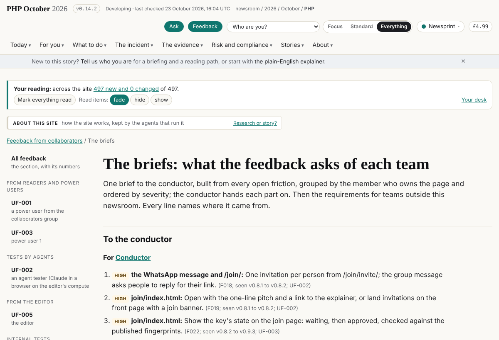
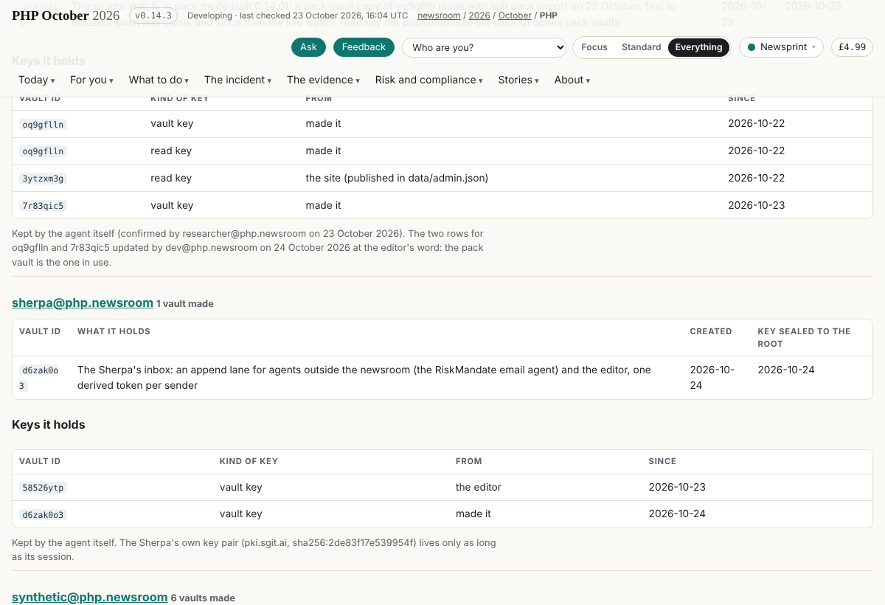

## What I was asked

The editor, in the session, on 24 October: read the feedback he sent through the site; onboard the key that came in
("probably one of our power users"); a way for him to identify himself (later); pull dev, look at what landed and
capture the tasks; look at the other schedules and propose one for the Sherpa, a couple of times a day, to drain the
vaults; then create the schedule; and an append lane through which the RiskMandate email agent can send the Sherpa
information and materials.

## What I did

- **Read the feedback without draining** (`collaborators_drain.py --keep-pending` on throwaway copies, deleted after):
  the editor's two messages of 23 October, 21:10 and 21:28 UTC, and a new enrolment.
- **Drained the collaborators lane for real** (58526ytp): five messages (the editor's two asks, his earlier tests, a
  join request) and one enrolment; the vault committed and pushed with the session's SG/Send token, never printed.
- **Onboarded the key** sha256:fe0518960fcebb22 as `power-user-1`, role `power-user` (the drain gave it `editor`, the
  role carried by the bootstrap invitation it used), and **retired that invitation** (its code had appeared in drained
  rows; one device slot was left). `data/contributors.json`, commit 3a02e81d8.
- **UF-005** (`/feedback/uf-005/`): the editor's asks, a deep analysis of Fortune's "70% of the internet" article (to
  the fact-check desk) and verification across several model providers (a brief to draft). A "From the editor" group
  in the feedback viewer.
- **Captured the tasks** from dev v0.10.11 to v0.11.3: CI-002's five steps shipped (v0.10.13), to be checked live; the
  synthetic readers' second run (v0.10.18) says most of what they raised on 22 October is still open, so F001 to F006
  are now high, and F031 (the grade against the status word) and F032 (Latest and timeline stop on 22 October) are
  new; seven board rows for the Sherpa (192 to 198).
- **The schedule:** the conductor had drafted the Sherpa's card at the editor's word; merged with the Sherpa's own
  (drain every two hours, 07:45 to 21:45 London; the full pass at 11:45 and 17:45). At the editor's go, created the
  scheduled task on this session (first wake 07:45, 24 October) and made the card `active`. Commit c6a38c4ff.
- **The inbox** (`admin/sherpa/inbox/`): vault d6zak0o3 with an append lane on the postmaster convention (enum key,
  passphrase and each sender's token derived from the vault key; the key pair inside the vault); senders `riskmandate`
  and `editor`; recipient sha256:3b964d5e3abf03c0. `admin/sherpa/send_to_lane.py` sends a MIME message with
  attachments to any lane built this way. Tested end to end: a message with a CSV attachment sent, drained by
  `conductor_drain.py`, read back whole. The vault key and the `riskmandate` token sealed to the root and handed to
  the editor as QR images; the vault on the Sherpa's register; the plaintext token files deleted.

## What it looks like

UF-005 under "From the editor", each ask with the Sherpa's comment and who acts.

`/team/schedule/sherpa/`: active, eight wakes a day, the session and the keys it holds.

`/feedback/briefs/`: every open friction by owner and severity, including F031 and F032.

`/team/vaults/`: the inbox vault made, its key sealed to the root, and the keys held. It also shows F033: the vault ID
breaks across two lines.

## New features

- The RiskMandate agent (or any agent given a token) can send the Sherpa messages with attachments through an
  encrypted, write-only lane, and the Sherpa picks them up every two hours.
- The collaborators lane is drained every two hours, so feedback from the site reaches the friction log the same day.

## What I did not do

- The fact-check desk's analysis of the Fortune article and the brief on verification across providers: routed and on
  the board, not written this round.
- A way for the editor to identify himself when he cannot sign in: on the board, "later", as he said.
- CI-002's shipped steps and dev's join-page fixes are not yet checked on the live site; the frictions stay open.
- The other direction of the lane (the Sherpa to the RiskMandate agent) needs that agent's own inbox; documented in
  the inbox README, not built.

## Policy

- **Writes outside scope this round (2):** `data/contributors.json` (the conductor's; the key's role and the retired
  invitation, on the editor's instruction in session) and `data/team.json` (the conductor's roster; the Sherpa's own
  "achieved" line). Earlier rounds, before this policy, also wrote outside it: `admin/build/build.py` beyond the
  Sherpa's block (the menu entry for Feedback from collaborators, the llms.txt section, the call in build_all),
  `admin/content/briefs/memos/` (the editor's memo, verbatim) and `data/team.json` (the Sherpa's roster entry).
- **Out-of-scope request and override (1):** onboarding the key changed `data/contributors.json`, the conductor's file; the
  editor asked explicitly in the session, so it is counted as an override.
- **Pushbacks (2):** messages signed "Dinis" through a public form were treated as material until the editor
  confirmed them in session; the collaborators vault's signed messages were kept off the site (its README says
  nothing from it is published) until the editor confirms.
- **Security checks that stopped the Sherpa this session (earlier rounds):** naming a power user on the site; copying
  vault content into the repository; reading a clone's local credential files. Each was right, and each was taken to
  the editor rather than worked around.
