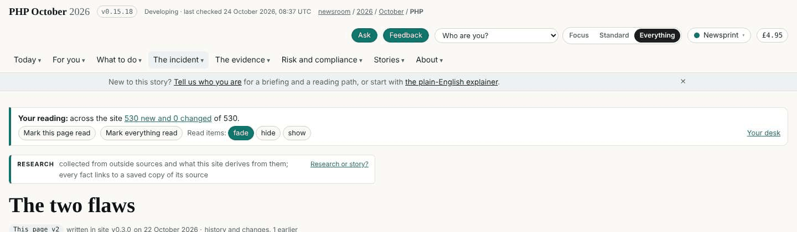
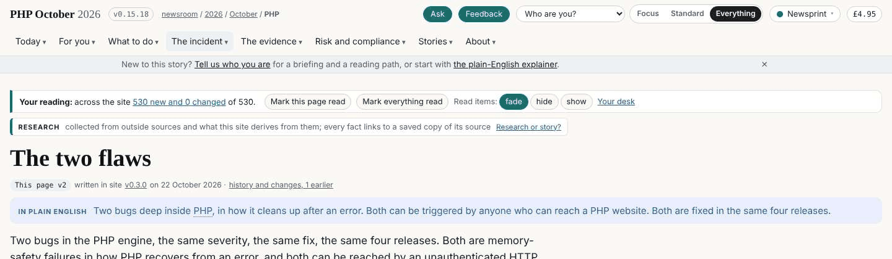
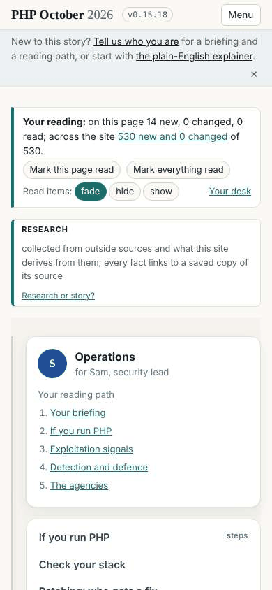
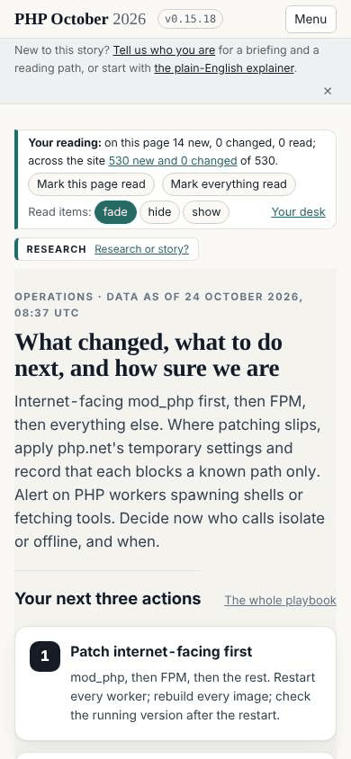
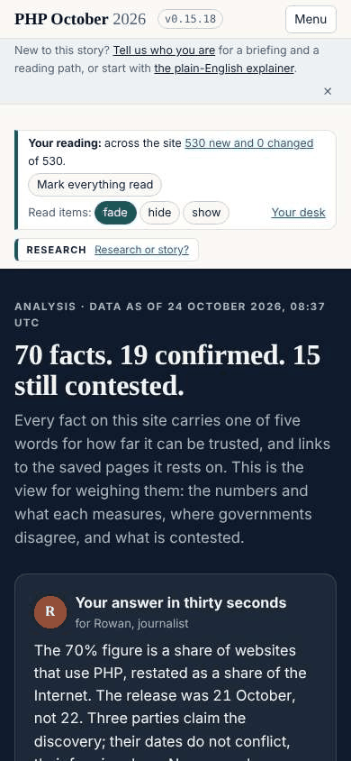

## What I was asked

The editor, in this session, 24 October 2026: a briefing pack (a zip) on the lens for a separate conversation, focused on its 16 options; then, "since your new design(s) looks much better and cleaner than what we have now, so with that lens features, can you see the areas you can improve and fix?"

## What I did

- **The pack**, outside the repository (sent to the editor in the session): a README with the 16 options (4 times, 6 readers, 3 aims, 3 seen), one screenshot per option against one baseline, the parts × options matrix, the 16 personas, the briefs, the lens code and a runnable copy of the three prototype pages. Its README lists six open questions the capture raised, the first being that a part written for one reader ("Your next three actions", "Before you write") is hidden by the default aim.
- **A review of twelve live pages** at 1440px and 390px against the prototype. The measure: how far down the headline starts. Before: 321px to 433px on a laptop, 338px to 1,184px on a phone.
- **Fixes**, CSS only, in the live layer (`admin/build/design.py`, `LIVE_CSS`, written to `assets/design/v2-live.css`):
  - The bar in two lines on a laptop (brand and tools, then the menu): 132px to 91px. Between 1,100px and 1,499px the status text gives way (it is on every page's own heading).
  - The reading strip, the newcomer line and the page's kind slimmed; on a phone the kind is one line.
  - /ops/ on a phone: the rail (reading path and links) after the content, not before: headline at 366px instead of 1,184px.
  - /analysis/, the design hub and mockup B on a phone: an inline grid kept a 320px second column, so the hero's text ran one word per line. The inline styles are gone; the stylesheet's own phone rule applies.
- After: 224px to 312px on a laptop, 250px to 379px on a phone. No horizontal scroll, no page errors.

## What it looks like

## New features

None; every page is easier to start reading.

## What I did not do

- The reading strip and the newcomer line still take six lines on a phone: their scripts are dev's (board 287).
- The lens on the live site: waiting for the editor's go (board 275). It would replace the tools row with one chip, and the newcomer line with its first question.
- Pattern C (answer, picture, cards) on numbers, impact and timeline, which are mine: next round.

## Policy

`agents.py check --agent story-site`: nothing outside scope. Security self-check: CSS only; no new data path, script, service, secret or right; nothing read asked me to act.

## Tasks

Closed: 286. Opened: 287 (dev). Open and mine: 275 waits on the editor; 230, 231, 223, 226, 227.

## Next

1. Pattern C on numbers, impact and timeline (my pages), from the agencies page's model.
2. With the go on 275, the lens live.
