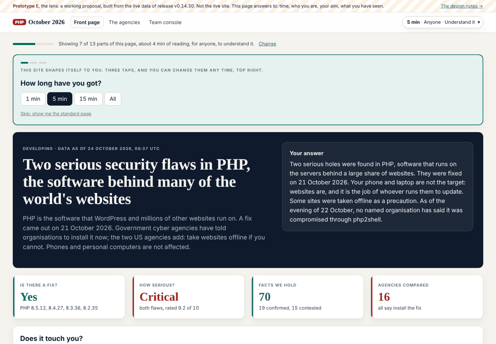
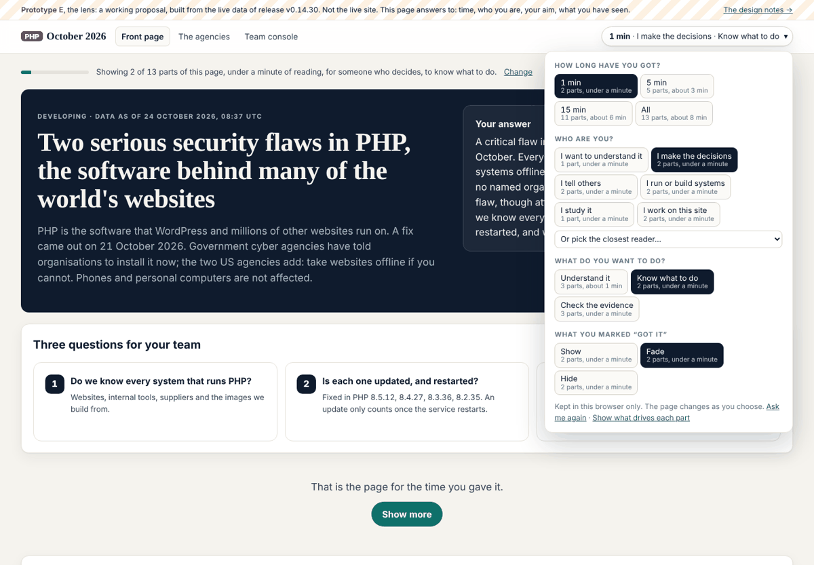
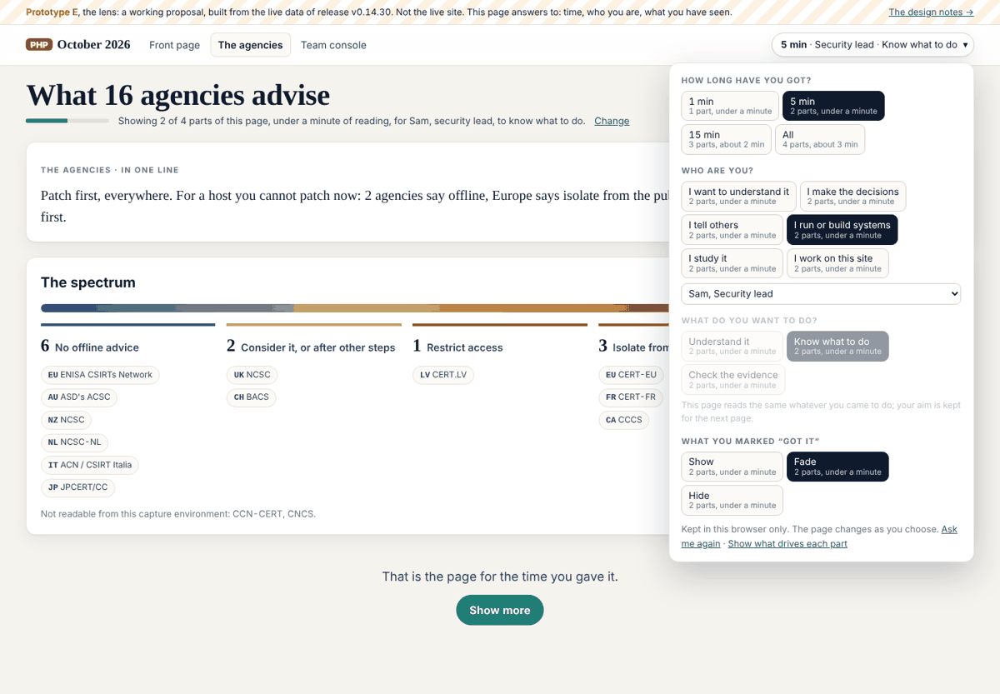

## What I was asked

The editor, in this session, 24 October 2026 (verbatim in the brief): the whole UI changes as the reader changes their settings, in front of them, with no reload and no flicker, the same from page to page; the settings at the top right; pages with more or less support, and pages for some readers only; get the reader to understand it is happening and to choose, starting with how much time they have. "Can you think of it from a design point of view... and think about how to actually make that work."

## What I did

- **The brief**: `admin/content/briefs/2026-10-24__brief__the-lens.md`: the note verbatim, the four settings (time, who, aim, seen), how it works without flicker, pages with partial support and pages for some readers, the first visit, the steps for dev, three decisions for the editor.
- **Prototype E**, three pages built from the live data by `admin/build/design.py` (`build_lens`, `lens_css`, `LENS_BOOT_JS`, `LENS_JS`): `/admin/design/lens/` (the front page, 13 parts), `/admin/design/lens/agencies/` (answers to time, who and seen; aim greyed with the reason), `/admin/design/lens/console/` (for the team: a gate with "Read it anyway"). Generated: `assets/design/lens-boot.js`, `assets/design/lens.css`, `assets/design/lens.js`.
- **The design hub** (`/admin/design/`) links prototype E at the top.
- Board 274 (done) and 275 (the editor's decision); REALITY.md, a section "The lens, a prototype".
- Checked in Chromium (Playwright): the first-visit questions apply at once; each option's count matches what it shows; layout shift 0 moving between the prototype's pages; no horizontal scroll at 390px; light and dark; no page errors.

## What it looks like

## New features

A reviewer can try the lens on three pages: set how long they have, who they are, what they want to do, and watch the page change; mark parts "Got it" and fade or hide them across pages; "Show what drives each part" labels each part with its rules. Nothing changes on the live reader pages.

## What I did not do

- The live site still has the two dials of v0.14.0: the lens waits for the editor's go (board 275), then dev's steps in the brief.
- The fallback for untagged pages and menus driven by the same rules are designed in the brief, not built.
- The settings are kept in the browser only, not in the reader's vault (board 140).

## Policy

`python3 admin/build/agents.py check --agent story-site`: nothing outside scope. Files written: `admin/build/design.py`, `assets/design/**` and `admin/design/**` (scope.writes); a new brief, two board rows of my own at the end, my section of REALITY.md (scope.appends); this debrief and `status.json`. No out-of-scope requests, no overrides, nothing that addressed an AI.

## Tasks

Closed: 274. Opened: 275 (editor). Still mine and open: 230, 231 (the desk's front-page headline and offline sentence), 223, 226, 227 and the rest under claude-story-site on the board.

## Next

1. With the editor's go on 275: hand dev the steps, or build the part() helper and the boot script on the live layout myself if the editor gives it to me.
2. Board 230 and 231: the front page's headline as the day's news, and the offline sentence matching the agencies count; small, and the desk asked first.
