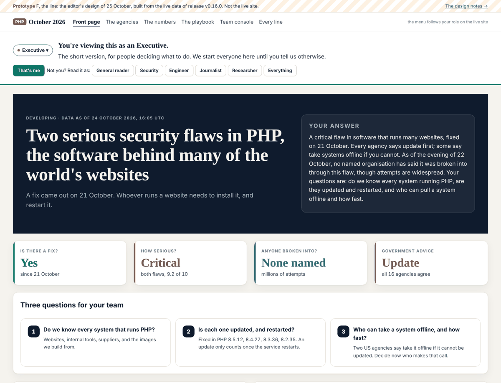
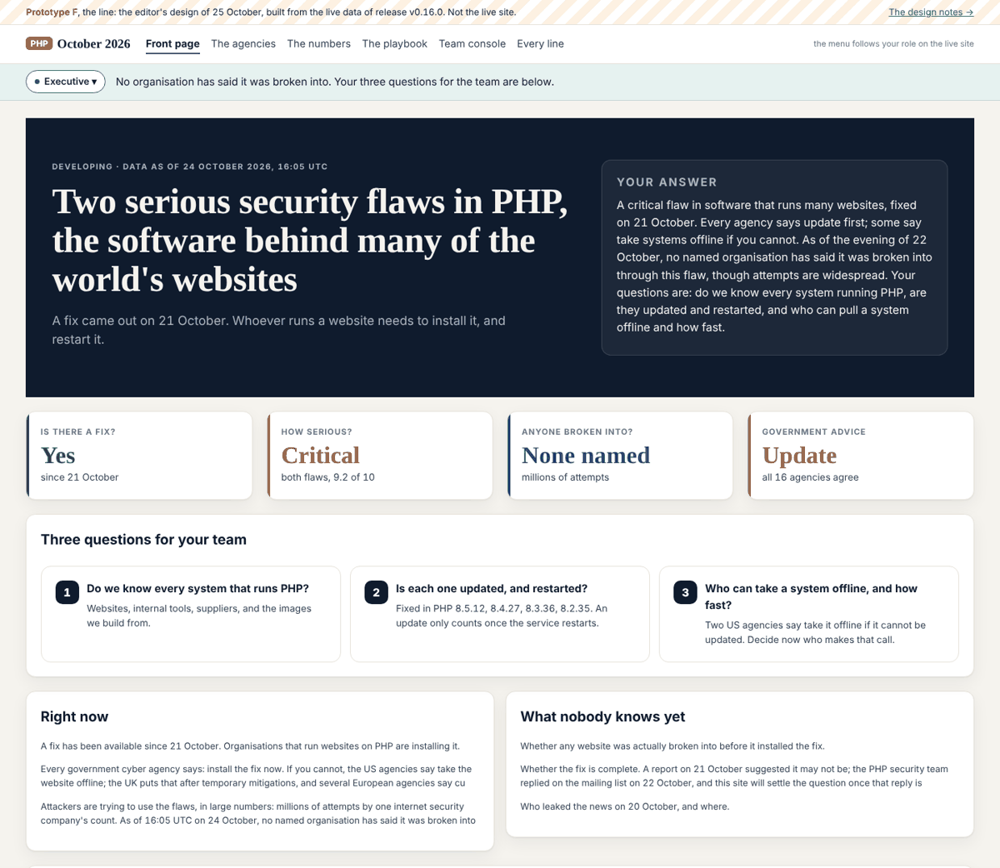
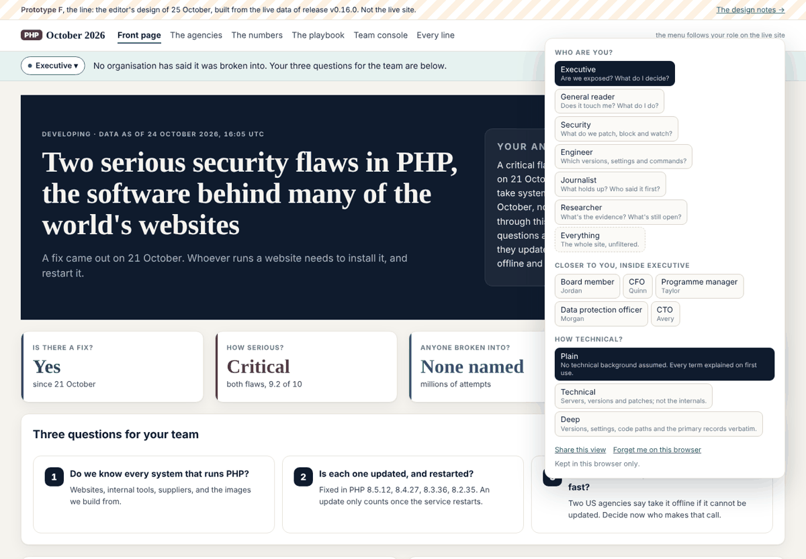
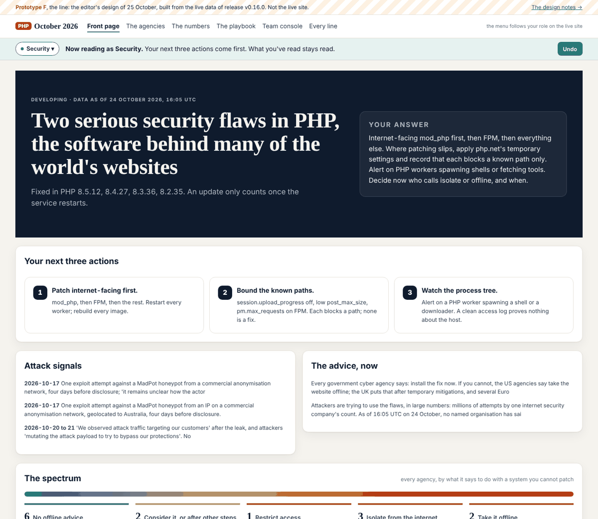
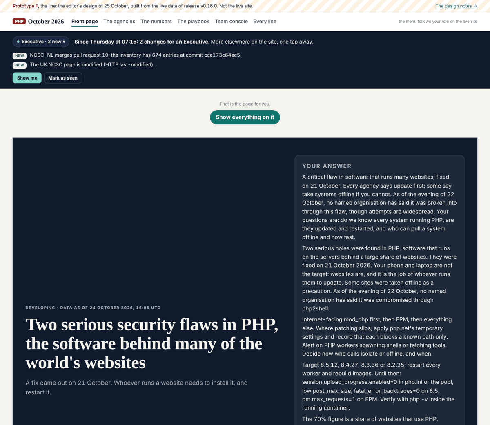
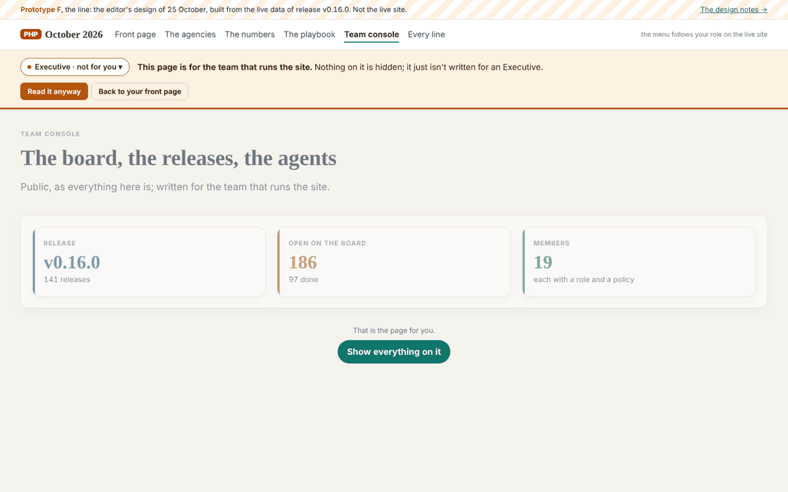
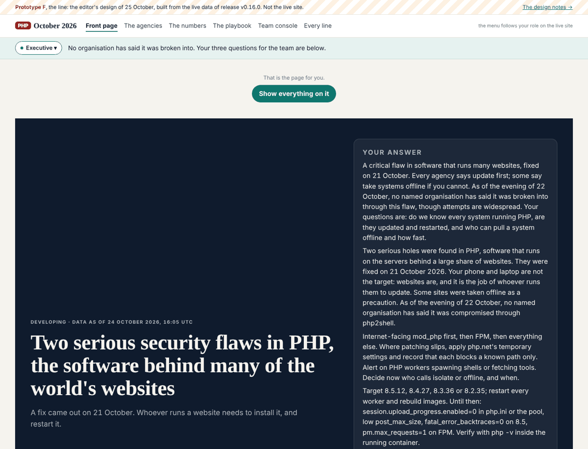
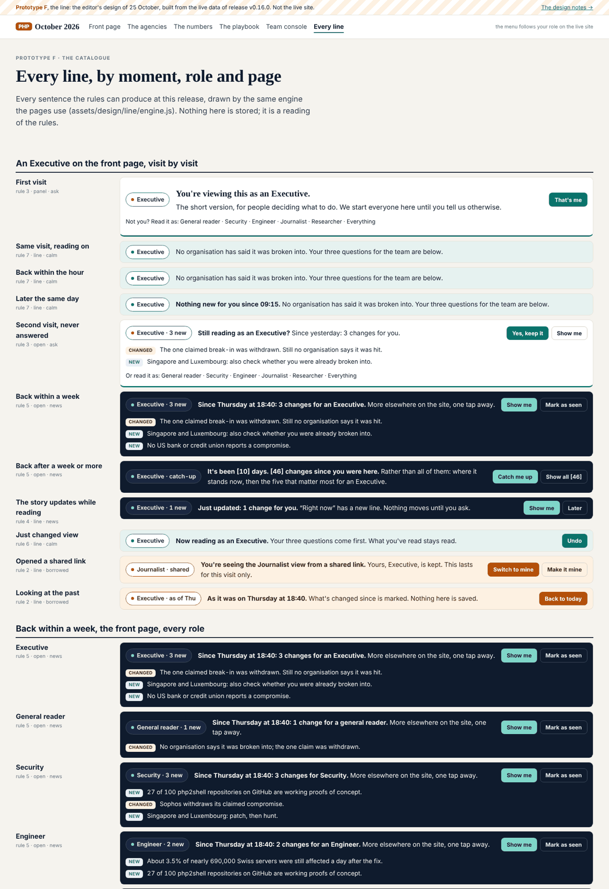
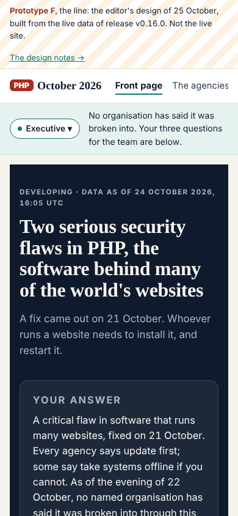

## What I was asked

The editor, in this session, 25 October 2026, with a briefing pack attached (`the-line-pack.zip`): "can you implement this design?" The pack is the design session's output: a brief, the seven roles, every word the line can say, the eleven visit moments, a storage schema, a reference engine with 19 tests, a standalone prototype and the journey screenshots. Its own starting prompt asks for prototype F first, built from the live data, for the editor's go, then the rollout on the live pages in the brief's order.

## What I did

Built prototype F at `/admin/design/line/`: six pages, every word and number from the evidence vault of the release they were built in.

- **The pack, vendored unchanged** under `assets/design/line/`: `engine.js` (the pack's pure, tested engine), `engine.test.mjs`, `roles.json`, `moments.json`, `storage.schema.json`, and `copy.src.json` (the pack's words, with the story's numbers turned into placeholders).
- **The site's own runtime**, written here: `boot.js` (blocking, in `<head>`: reads the record, the session, the URL and the referrer, works out the role, the depth and the moment, writes them on `<html>` before the first paint), `line.js` (gives the engine the state, draws the line, keeps the record, the control, seen and folding, shared links, the past view, the live-update poll, and the catalogue), `line.css`.
- **The build** (`admin/build/design.py`, `build_line`): generates `copy.json` (the pack's words with this release's numbers), `config.js`, `shape.css` (which parts each role sees and in what order, from `roles.json`), the six pages and their markdown twins, and the change log, read from `data/timeline.json` and tagged by phase.
- **The pages**: the front page with sixteen parts, shown and ordered per role; the agencies, the numbers and the playbook, each with a line per role; a page for the team behind the gate; and a catalogue of all 34 lines the rules produce, drawn by the engine in the browser.
- The brief is in the repository (`admin/content/briefs/2026-10-25__brief__the-line.md`) with a note on what was built against it; the design hub links prototype F above the earlier mockups; REALITY.md has a section; board 296 to 299.

**Checked.** The pack's 19 tests pass against the vendored copy (`node --test assets/design/line/engine.test.mjs`), including "no placeholder is ever left in braces, for every role, moment and page", which is also the check that every number came through from the vault. In Chromium: the first visit panel, the seven roles, the three depths, all eleven moments (first, reading, hour, sameday, second, week, long, live, switched, shared, past), the gate, folding, Undo, "Make it mine" and "Forget me". No page errors; nothing moves above the fold, because the line's row is reserved before the first paint.

## What it looks like

## New features

A reviewer can read the same page as any of the seven roles at any of three depths, watch it re-lay in place, come back later and see what changed for that role and what folded away, open a shared view without losing their own, look at a date in the past, meet the gate on a team page, and read every line the rules can produce on one page. Nothing on the live reader pages changed.

## What I did not do

- **The live site**: it still carries the two dials of v0.14.0. The rollout waits for the editor's go (board 297, which supersedes 275).
- **A page line for every page**: four pages have their own; everything else would fall back to the page-title line (board 299).
- **The change log from the build's diff between releases** (brief 10.5): prototype F reads the story's own dated timeline and tags it by phase. Honest material, but not the same thing.
- **The reader's vault and telemetry** (boards 140 and 262): the record is kept in the browser only.
- `boot.js` is 3.4 KB, not the brief's "under 2 KB"; it duplicates the ladder so it can run before the engine loads. `line.js` re-derives with the engine after first paint, so the engine stays the one source of truth.

## Policy

`python3 admin/build/agents.py check --agent story-site`: nothing outside scope. Files: `admin/build/design.py`, `assets/design/**` (scope.writes); a new brief, board rows of my own, my section of REALITY.md (scope.appends); this debrief and `status.json`.

Security self-check, the seven questions: every string the new scripts put on the page goes through `textContent` or `createElement`, never `innerHTML`; the only values read from a URL (`?as=`, `?depth=`, `?asof=`) are resolved against `roles.json` or parsed as a date and written back as words, so a script-shaped date renders as text (checked). No new outside source of text, no secret, no new service (the release poll is same-origin, `connect-src 'self'`), no inline script (the two islands are `application/json`), no new right for any agent. Nothing I read asked me to do anything.

## Tasks

Closed: 296. Opened: 297 and 298 (the editor), 299 (mine). Board 275 (the lens's go) is superseded by 297; I left the row for the editor to close. Still mine and open: 230, 231, 223, 226, 227, 287 is dev's.

## Next

1. With the go on 297: step 1 of the rollout, the line and the boot script on every live page with rule 7 and the fallback line, replacing the dials.
2. Board 299: a page line per page, for the desk to approve, and the change log from the release diff.
3. Boards 230 and 231, still waiting from the desk's review.

## After the release: the phone, and the article (same day, v0.19.0)

The editor, on an iPhone: the line must not hold the top of the screen, because a locked band costs too much of a
small screen. On a phone the line is no longer sticky; it scrolls away with the page and its sentence runs full
width. Measured at 390x844: the resting line 125px, the first-visit panel 253px, both scrolling away, the headline
394px down. `assets/design/line/line.css` only. Board 304.

He also asked, before any of it is built, for an article on moving the site to URL paths and a single page, with a
link that can name its persona. It is
`admin/content/briefs/2026-10-25__brief__urls-personas-and-a-single-page-site.md`, published at `/admin/briefs/` and
linked from the design hub: the rule that the URL carries what can be shared and the browser carries what is the
reader's, `/agencies/as/security/` as the shape (the page keeps its own path, the persona is a suffix), what that
needs from search engines, fragments and a router rather than a framework, the trap in rendering a page in two
languages, five steps that each ship on their own, and five decisions for the editor. Boards 305 and 306. Nothing of
it is built.

## The briefs page, and the width of the console (same day, v0.20.0)

The editor, with two screenshots: the briefs page is one wall of 57 briefs rendered end to end, and the console sits
in a narrow column on a wide screen.

- **Briefs**: `/admin/briefs/` is now a list of titles, newest first, each with its date, who wrote it and its first
  sentence, linking to its own page at `/admin/briefs/<the file's name>/`. 57 new pages, each with a markdown twin, in
  `llms.txt`, with older and newer links at the foot. Every link already published to
  `admin/briefs/index.html#<file stem>` still lands on that brief's row: the five in `build.py` were checked one by
  one. A brief that embeds an image needed its relative links deepened by one directory, which is `deepen_links()`.
- **Width**: under `admin/` and `team/` the main column has no maximum width; the reader pages stay at 1,440px. Prose
  keeps its 82ch measure, so only the tables, lanes and cards take the extra room.

**Policy.** `admin/briefs/**` is the editor's own page in `admin/content/agents/editor/policy.json`, and the briefs
block lives in `build.py`, so this is a write outside story-site's scope. The editor asked for it explicitly in this
session, which is the one override the rules allow; it is counted in `status.json` (`policy.overrides`: 1) and named
here. Boards 309 and 310.
