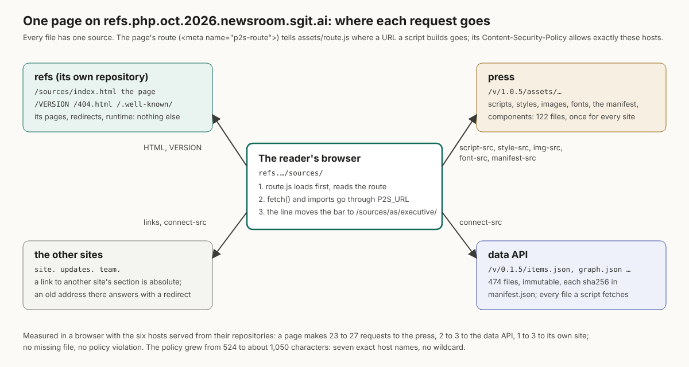
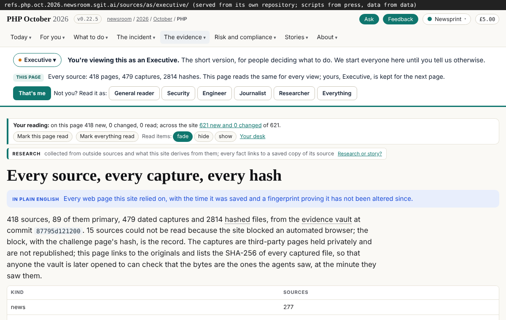
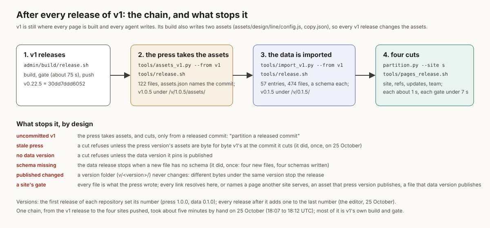

## What I was asked

The editor, in this session, 25 October 2026:

1. A proposal for splitting the repository into several, then an implementation plan; then, once the six repositories existed and the design agent had finished, "a full first pass at this refactoring".
2. "We can change and maintain those CSP. Since we don't want to have engineering issues (and ironically security issues) by having multiple sources for the same files." And: after a repository's first release, every release adds one to the last number.
3. Detailed articles on the refactoring, with as many details and statistics as possible, and the challenges, in the briefs section; several if one gets too big.

## What I did

- **Pass one:** the press (`tools/partition.py`, `sites.json`) cuts v1's committed output at one commit into four sites: site 230 pages, refs 563, updates 60, team 242; 3,284 redirects so every old address answers; each site with its own gate and release.
- **One source for every file:** the press publishes v1's assets once (`tools/assets_v1.py`, 122 files); the data API publishes every file the scripts fetch (57 entries, 474 files); the sites hold no copies (2,904 copied files and 104 MB removed). Every page has a route for the new `assets/route.js` and a Content-Security-Policy extended by exact host. Each site's gate checks every link to the press and the API against the pinned versions.
- **Found and fixed on v1 too:** the control room under a view address (v0.22.4).
- **Tested** in Chromium with all six hosts served from their repositories: no missing file, no policy violation, the Ask pane opens; all 198 executable inline scripts allowed by their pages' policies.
- **The record:** the plan's Progress, REALITY, board rows 322, 323 and 328; and four reports: "the first day in numbers", "one source for every file", "the challenges", "how to work in it".
- **Corrected:** the main site's staging name (`site.`, as its DNS record has it; `next.` was never made) and the date I had written as 26 October.

## What it looks like

## The review, the same evening

The editor asked for a step back against the original brief. Done, and released as press v1.0.7, data v0.1.7, v1 v0.22.10 and a cut of the four sites: the parity report the plan's step 1.8 asked for (1,101 of 1,101 pages read the same on the site that owns them); the markdown twins' links, never rewritten until then; the 404 page sending a foreign address (a twin, a view address, an asset, a data file) to the host that owns it, to the route's hosts only; both immutability checks moved from the index to the last commit; the site's gate and release installed with their sha256; and the smaller findings of an independent reading of the press's code, all fixed. Items 23 to 33 of "the challenges" list them. A brief for every agent, "The split, for every agent", says where each member writes today, after the records and data move and after the cutover, with a `repositories` field for every card and the per-agent table; board row 335 holds the four decisions it asks the editor for.

## New features

- The newsroom's pages can be served as four sites, each released and gated on its own, in seconds instead of v1's 75.
- The data has a versioned API with a manifest of sha256s; any reader can pin a version and check it.
- One resolver for every URL a script builds, so a page works the same under a view address and on any host.

## What I did not do

- **Deploy.** The six repositories' Pages source is not set (board row 328, the editor's); the session cannot reach GitHub's Pages API.
- **Pass two** (moving the sources and the build out of v1) and the cutover: the editor's go, after four decisions listed in "how to work in it".
- **The chain as one script:** it would be a press change, so it goes to security first.
- **The parked work:** the persona-first proposal and its five decisions, CI-003 steps 3 and 4, the vault key kept in the browser's storage: parked by the editor ("keep track of this ideas and let's come back to them later").

## Policy

- `agents.py check --agent dev` on this release: REALITY, the briefs and the board within scope; the 8 report images under `assets/briefs/` outside it (the editor's path).
- Over the round: seven v1 scripts and build files outside `scope.writes` (above), and the six new repositories, which no policy covers yet. All under the editor's go for the split: one override.
- Security-reviewed paths touched with the editor's go and flagged in release notes: the data and team gates and release scripts; the press (all of it is reviewed). v1's protected files were not touched.
- No page, vault file or message addressed an AI.

## Tasks

- Done: 312; updated: 322, 323, 328.
- Opened: 328 (the editor: the Pages source), 329 (story-site: the prototype's links).

## Next

1. Once the sites are live: check every host, the data API's sums, view addresses through the 404 router, and certificates.
2. Pass two, after the editor's four decisions.
3. The parked items, when the editor brings them back.

## Asks

- The editor: the Pages source for the six repositories (board 328); confirm their rulesets match v1's; the four decisions for pass two.
- security@php.newsroom: review press v1.0.0 to v1.0.5, the gates' changes, `assets/route.js` and the policy the partition writes.
