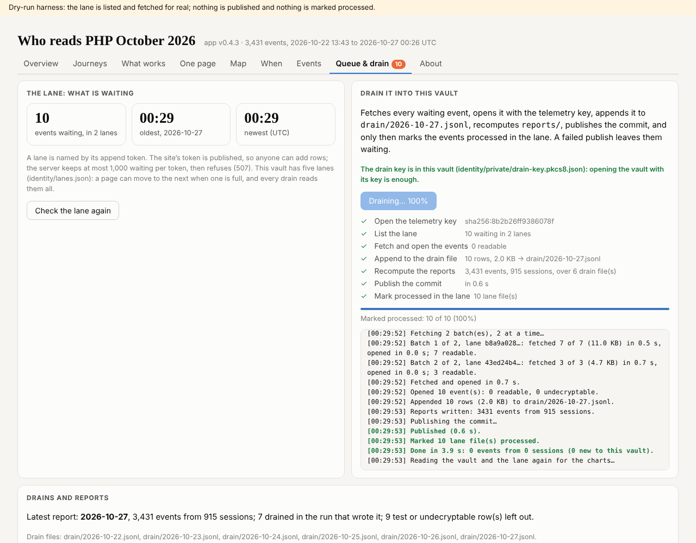

## What I was asked

The editor, in this session, 26 and 27 October 2026: run on a schedule at least three times a day, wired into the six
repositories as the other agents were; the lane hit 1,000 "due to crawlers"; "four or five append lanes that the UI can
use when one fails"; and make the drain faster, in parallel.

## What I did

- The card `records/schedule/observability.json` (08:33, 14:33, 20:33 London; push team, pull press and data, never
  v1), and at the editor's go the scheduled task `trig_01B9ULDBk3Mux6HzEkFQ7wZQ`, firing into this session with the
  card's instructions as its prompt. The card is active. sgit-ai upgraded to 0.25.0 (status 5.3 s then 1.3 s on 84wr8mib).
- Why the lane filled: one Googlebot rendering session, 960 events over 811 pages of the newly live sites between 17:00
  and 19:23 UTC on 26 October, 906 of them not declaring a bot. The lane refused everything for about 4¾ hours; about 60
  to 80 non-crawler events were lost (an estimate from the day's rate), 10 to 15 of them readers'.
- Five lanes on the telemetry vault: `records/desks/observability/lanes.py` derives lanes 2 to 5 from the write key,
  configures all five anchors (lane 1 the site's token), and records them in the vault's `identity/lanes.json`. Every
  lane tested with an event marked `test` and drained.
- Found an SG/Send bug: lane configuration is cached per server instance and never refreshed, so new lanes answer 404 on
  stale instances for a while (4 of 12 writes accepted at first, 7 of 8 twenty minutes later). Board observability-0002.
- The drain in parallel: the application v0.4.3 (pushed to 5wnsr5h8) and `drain.py` fetch, open and mark four batches at
  a time, rows still in the lane's order. 43 tests pass over 3,431 events; checked in the dry-run host across two lanes.
- The page's side (`assets/telemetry.js`, dev's, in the press): the code in
  `records/briefs/2026-10-27__brief__five-lanes-and-a-cap-per-tab.md`, board observability-0001: the five lanes with a
  fallback on 507, 404 and 5xx, and at most 40 events a tab.
- Drained: 4 events, then the lane tests. The vault holds 3,431 events from 915 sessions; the lane is empty.

## What it looks like

## What I did not do

- `assets/telemetry.js` and `data/telemetry.json`: dev's (press, data). Until they change, pages use lane 1 only, and
  the cap is still 1,000.
- A timing of the parallel drain on a full lane: the lane was empty; the first scheduled wake with events will say.
- Five of my test events first went out encoded once instead of twice and came back undecryptable; I removed those five
  rows (mine, labelled) from `drain/2026-10-27.jsonl` and sent them again correctly.

## Policy

No write outside scope. The security self-check: the tools print no key or token (the access token lives in a 0600 file
in the session, passed by environment); append tokens are publishable; the test events carry `test: true` and nothing
about anyone.

## Tasks

Opened observability-0001 (dev) and observability-0002 (conductor, for SG/Send). 270 and 272 still open.

## Next

The first scheduled wake, 08:33 London: drain, the parallel timing, and what came in.
