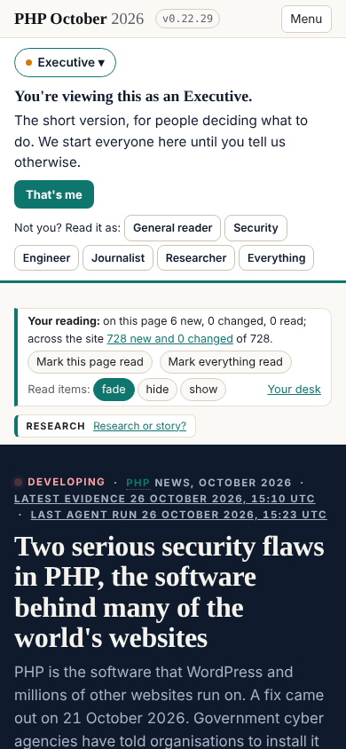
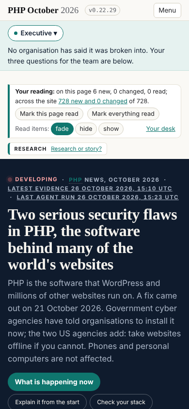
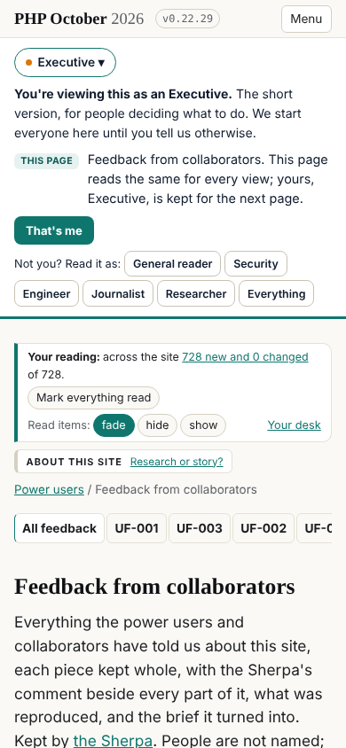

## What I was asked

The editor, in the session, on 26 October: pull every v2 repository, which the Sherpa should now be using, and run its
tasks and actions as its guidance says; the schedule is not re-enabled yet. Before that, comment on his LinkedIn post
announcing v2 (done in the session, not published here).

## What I did

- **Took in the six repositories.** team and press attached with push; site, data, refs and updates cloned read-only.
  v1 left untouched (frozen since step B); `records/WAKE.md` followed from team.
- **sgit 0.25.0** (from 0.24.0, WAKE.md 1b): `status` on the collaborators clone 2.5 s first, 1.6 s second; on the
  inbox clone 1.6 s and 1.3 s. Nothing behaved differently.
- **Drained both lanes.** The inbox (d6zak0o3): nothing. The collaborators lane (58526ytp): one feedback message, signed
  with the editor's enrolled key, no enrolment. The press's collaborators drain cannot run in v2 (its root is the v1
  depth): board **sherpa-0001** to dev, and the drain run from a scratch layout with data's `contributors.json`.
- **UF-006**: the editor's phone review of mockups A, B and D, five points, each reproduced on the live v2 site. The three
  layout problems exist in the mockups only; the question (what a first-time visitor sees before choosing a reader)
  holds on every live page: the headline 598px down on a first visit, 425 once the reader chooses.
- **Frictions**: F035 closed (the line's chooser is the first step it asked for), F036 closed (checked live on team),
  F037 improved (the chooser folds after the first choice), **F038** new (the 'Your reading' panel above every headline,
  even for a reader who has read nothing).
- **The card** (`records/schedule/sherpa.json`): the `repositories` field, every v1 path moved to its home in the six,
  the steps rewritten for team, the drains in the press and a run record released from team every wake.

## What it looks like

v0.22.29, first visit: the reader chooser and 'Your reading' above the headline (598px).

The chooser folded into its pill; the headline at 425px. What is left above it is 'Your reading' (F038).

`team.php.oct.2026.newsroom.sgit.ai/feedback/`: the menu one scrolling row (F036, closed).

## What I did not do

- The scheduled task's prompt: left as it is until the editor re-enables the schedule; the card's `instructions` field
  already holds the v2 prompt.
- UF-006's screenshots are not published: they are of the mockups, and the live pages show the state now.
- The interviews brief (board 331 to 334) waits on the editor, unchanged.
