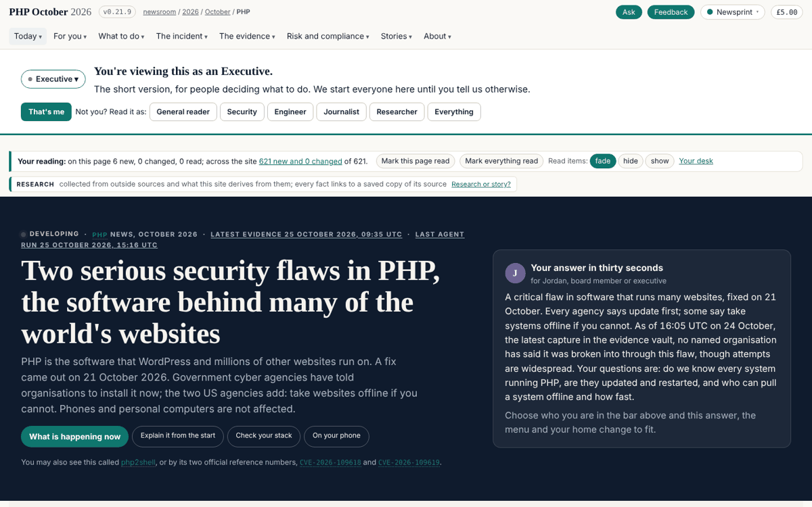
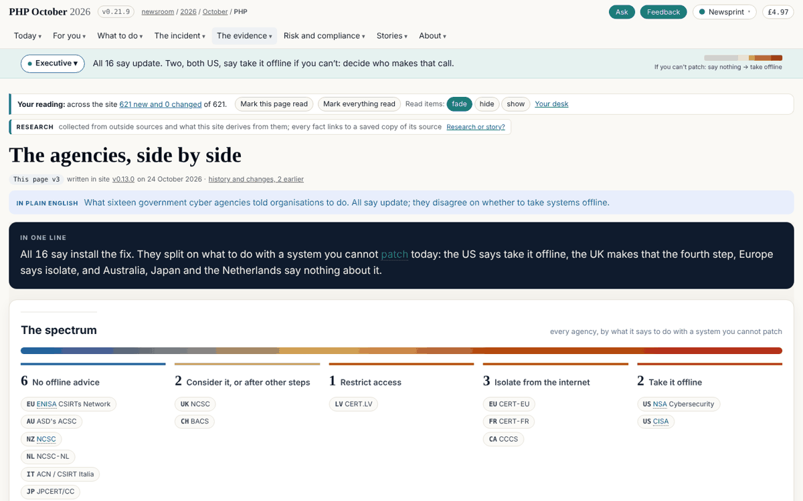
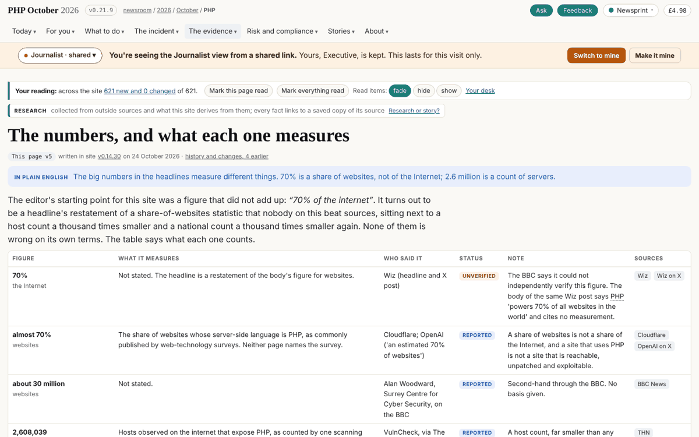
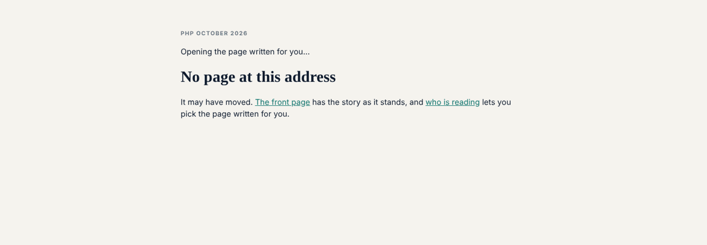
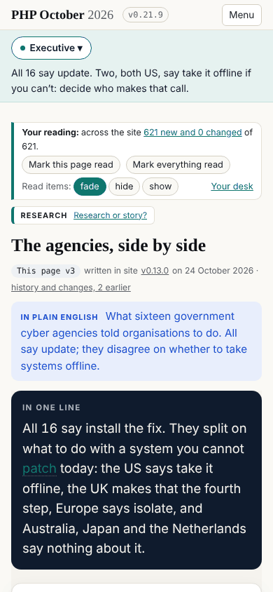
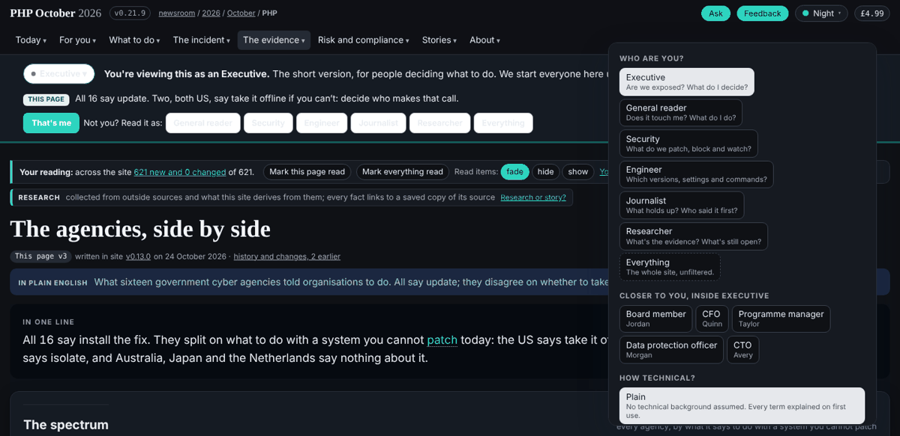

## What I was asked

The editor, 25 October, having read the router notes: "it's spot on ... I approve all this": previews as cards for the pages
likely to be linked; the front page stays the Executive's, with the address rewritten so the reader sees "as executive";
the reserved words; and not to wait. Asked two questions, he chose that story-site changes dev's scripts itself, and that the
line goes live with the router.

## What I did

- **The line on every page**, in place of the two dials: the band under the bar, its boot script before the first paint,
  `config.js` carrying the change log so a page needs no island, the front page's answer card following the reader, and
  `p2s.persona` kept as a real persona id so the rest of the site keeps working. The older "Reading as" bar and the
  newcomer bar are hidden where the line runs: one message at a time.
- **The router**: `/404.html`, self-contained (its script inline, hashed by the site's policy, every link absolute), reads
  an address at its first reserved word, hands the view to the line for this visit, and opens the real page. Reloading a
  view address comes back to the same view. A missing page says so.
- **The address follows the reader**: every page rewrites the bar to `/<page>/as/<reader>/` (`/as/executive/` on the
  front page). Moving the address deeper would break every relative link, so every link is made absolute against the
  real page first (and every link added later, by a mutation observer), and every script resolves its requests against
  `window.P2S_BASE`, the real page, through a fetch shim in `boot.js`; `<base>` is ruled out by `base-uri 'none'`.
- **Cards**: 28 real files, the front page, the agencies, the numbers and the playbook for each of the seven readers,
  with their own preview title and description and a canonical link to the page; a "Read this page as" row at the foot of
  those pages links them (a tap switches in place where the line runs).
- **Dev's scripts**, under the editor's go: `ask.js` and `site-tools.js` build the Ask and Feedback module URLs from the
  real page; `telemetry.js` counts the real page; `sg-meter` (v1.3.1, in place) keys what a reader has paid for by the
  real page, so a view is never charged twice.
- **The build** refuses a real page whose path uses a reserved word as a directory.

**Checked**: 27 journeys in Chromium against a local stand-in for GitHub Pages (404.html served with status 404):
first visit, following links, reload of a view, switching role, the read-as row, a shared link with a saved view
(borrowed, "Switch to mine"), a view with no card, a dated address, a missing page, a fresh visitor from a link, the
cards' preview tags, the phone. No failed request and no page error. Headline at 256px on a laptop, 335px on a phone.

## What it looks like

## New features

A link can name its reader: `/agencies/as/security/`, `/as/cfo/`, `/playbook/as/engineer/`. Every page shows the reader's
view in the address bar, so copying it shares it. A pasted card link unfurls with who it is for.

## What I did not do

- Dated views (`on`, `vs`, `since`) are read and not applied: the site does not keep each release's pages yet.
- The reading path the older bar carried ("Next: your briefing") is not yet one of the line's actions.
- The gate still wants 404.html and the cards in the sitemap and llms.txt; the proposal to exempt them is security's.

## Policy

`agents.py check`: five files outside scope, all dev's (`ask.js`, `site-tools.js`, `telemetry.js`, `sg-meter.js`,
`sg-meter-core.js`), changed under the editor's explicit go in this session; counted as one override. Also under that
go: `layout()` in `build.py` and `/404.html`. Security self-check: the new inline script (404.html) is hashed by the
site's own policy builder; the fetch shim only turns relative URLs into absolute same-origin ones; the router matches
the address only against the known reader words, and nothing from an address reaches the page as markup; no new
service, secret or right. Nothing I read asked me to act.

## Tasks

Closed: 324. Opened: 325 (security), 326 (dev), 327 (mine). Boards 297 and 311 are the editor's to close.

## Next

1. The reading path back into the line; page lines for more pages.
2. The decks (board 314), on the same addresses: `/decks/as/<reader>/`.
