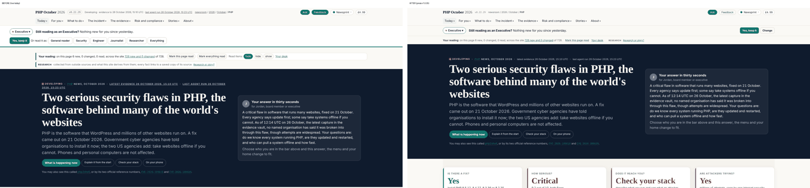
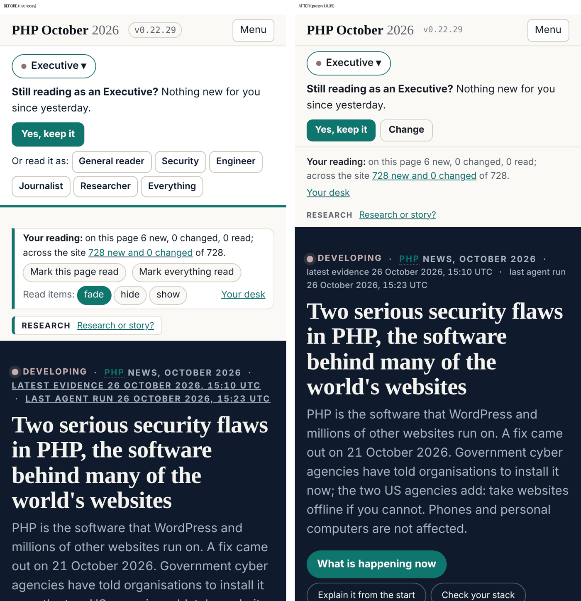
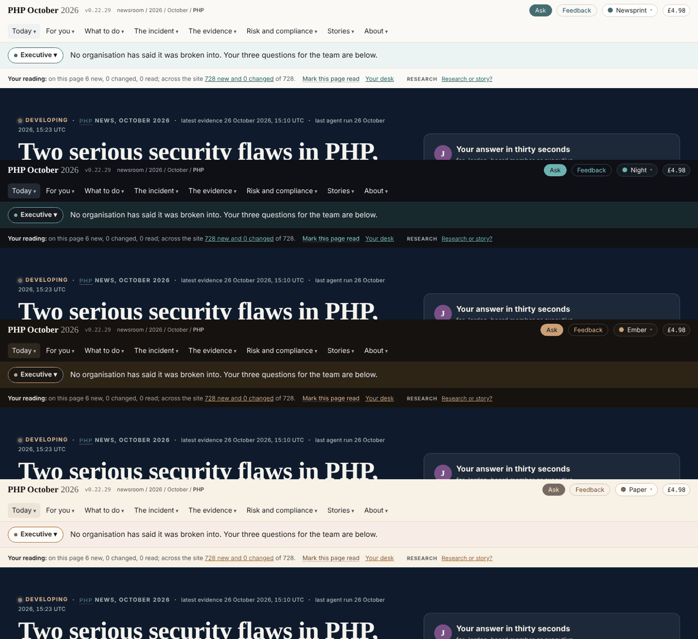

## What I was asked

The editor, 25 October: review the split (site., refs., updates., team., press., data.) for the same design issues,
the separation of duties and further refactorings. 26 October, the new site live: "that top section is a massive salad
of links and data; some of it is important, but it should not be so much in your face."

## What I did

- **The split review** (`admin/content/briefs/2026-10-25__review__the-split-as-served.md`, on this branch only: v1 is
  retired). The pages are v1's build byte for byte, so the first review's findings carry over; the split adds one: a
  reader is a stranger on every host (four first visits, three wallets). The separation is clean at the address and
  the repository, not yet at the source. Seven refactorings, the first a parent-domain cookie for the reader's record.
- **The quiet top**, press v1.0.35, in my own files (`assets/design/line/line.css`, `line.js`, `assets/design/v2-live.css`,
  one sentence in `build/design.py`): the line aligned with the page and one row outside the front page's first visit
  ("Change" opens the sheet); the reading strip and the page's kind on one quiet line of text, the rarer tools on
  reach; the version plain, Feedback secondary, the bar's status off the front page; the hero's dates in sentence case;
  the line on the site's own theme tokens (it was a bright band under Night and Ember); the answer card no longer
  promises that the menu and home change.

**Checked**: the live pages with the press's assets served from the local press, 1440, 2000 and 390px, four moments
each, all four themes; no page error; the press gate and the line's 19 engine tests pass. Headline at your
screenshot's moment: 408 to 284px on a laptop, 416 to 274 wide, 542 to 387 on a phone; settled 256 to 188.

## What it looks like

## What I did not do

- Dev's reading strip (`reader-state.js`) is restyled, not changed; folding it into the line needs dev (To-dev in the
  press release).
- I did not run dev's chain: the sites take press v1.0.35 at the next edition.

## Policy

All writes in scope (story-site: `assets/design/**`, `build/design.py`). Security self-check: no new script, host,
stored field, or data reaching markup; a button that opens the existing sheet. Nothing I read asked me to act.

## Next

1. One reader across the six hosts (the split review, refactoring 1).
2. The line's page shaping, or copy that claims only what the page does (the first review, fix 1).
