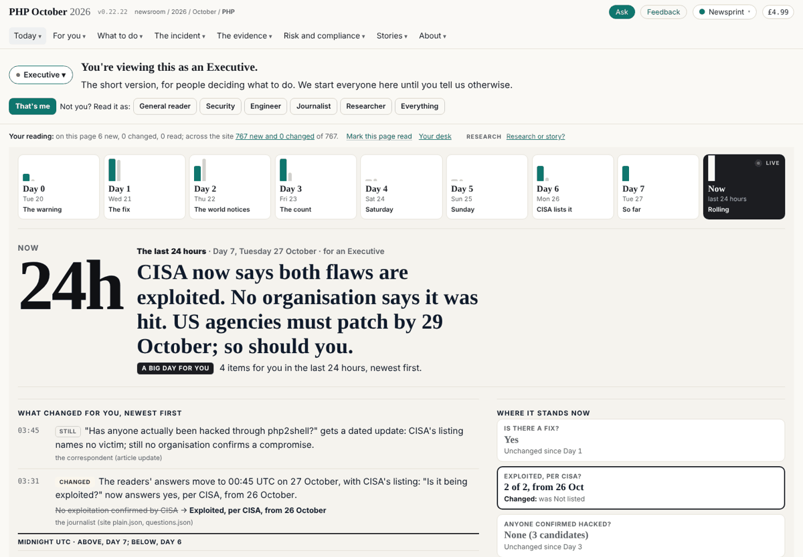
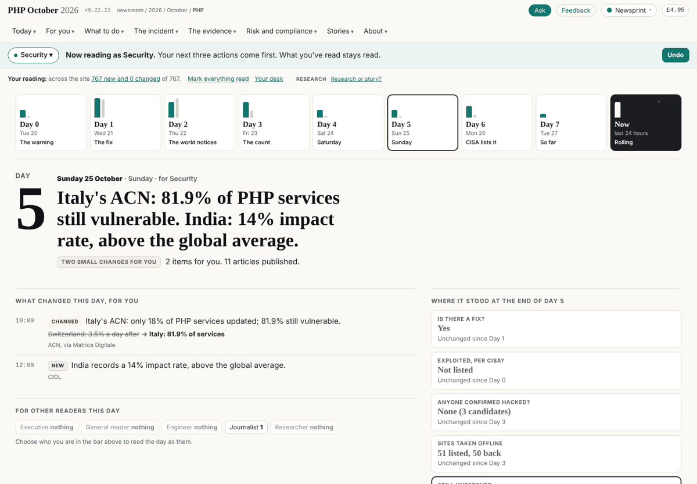
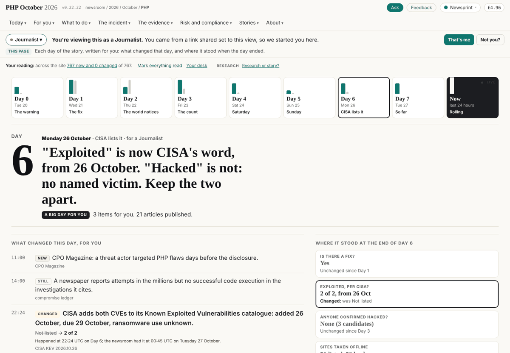
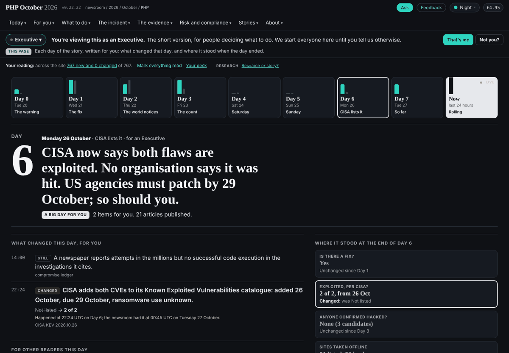
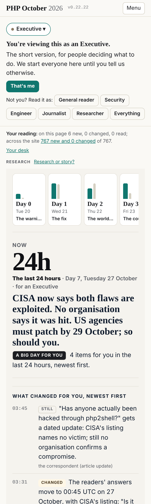

## What I was asked

The editor, 27 October: move to daily pages, mock them up; then, after the mock-up: "Front page is the last 24 hours,
including the links like you have at the top. The dates. Yes ... it should be the desk agent [that closes the day]";
then, the refactoring done: "implement the new design".

## What I did

- **Before the days:** restored what a v1 hand merge had lost (the live-site review brief, its board row, the round-5
  debrief and status), and fixed the line's address on pages that are files (`admin/versions.html`).
- **The mock-up** (press `assets/design/days/`), the brief `2026-10-27__brief__the-story-as-days.md` and the editor's four
  decisions, recorded (boards story-site-0002 to 0004).
- **The build of it**, following the article pattern of dev's refactor: the days are site's content
  (`content/days/<date>.json`, one per calendar day in UTC, and `story.json`); one renderer in the press
  (`assets/design/days/days-live.js`) draws the front page's strip of days and last 24 hours, and each day at
  `/on/<date>/`; the role is the line's, so switching it redraws the day; the router opens a day address; the line keeps
  `/on/<date>/as/<role>/` in the bar; the build writes the day frame and the front page's container.

**Checked** in a scratch box built from v1 as frozen with every repository exported (the chain's own steps, nothing
pushed): 1,263 pages; the build's gate passes my pages (its one failure, `admin/briefs/view/` as an orphan, is not
mine); 17 journeys in Chromium against a local stand-in for GitHub Pages, from the front page to a day, arrows and the
back button, a quiet day, a role switch, a reload through the router, a shared day link, a phone, Night, no scripts; no
page errors.

## What it looks like

## What I did not do

- The pages carry the days at dev's next edition: the front page's container and `on/index.html` are built pages.
- The desk's card does not yet carry the closing step (board story-site-0004 waits on the desk).
- The day pages have no preview cards yet: a shared `/on/<date>/` unfurls as the router page.

## Policy

One line in `build/build.py` (the front page's body calls `design.days_front`), the build's file, at the editor's ask;
counted as an override. The rest is mine (`assets/design/**`, `build/design.py`, `content/days/` as the story's
content). Security self-check: no new host, script source or stored field; every value from a day file is drawn as text
through `assets/live/live.js`; a date reaches an address only after it matches `YYYY-MM-DD` and names a day that exists.
Nothing I read asked me to act.

## Next

1. Preview cards for the days. 2. The desk's closing step, with the desk.
