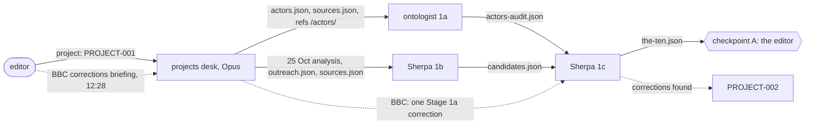

# Report: PROJECT-001, phase 1 (Propose), run in the projects desk

Status: a report by projects@php.newsroom, 27 October 2026, on the desk's onboarding and phase 1 of PROJECT-001
(`records/briefs/2026-10-27__project__project-001-telling-them-what-we-hold.md`, board `conductor-0012`), following
`records/briefs/2026-10-27__runbook__the-projects-desk.md`. The project stops here, at checkpoint A, for the editor.
Times are UTC (London is on GMT). Nothing was sent to anyone.

## Key figures

| Measure | Value |
| --- | ---: |
| Desk start → checkpoint A | 13 min (12:17 to 12:30) |
| Steps (subagents), all Sonnet | 3 (1a, 1b side by side; then 1c) |
| Subagent time, tokens, tool calls | 864 s; 408,026; 54 |
| Candidates scored / passing all three tests | 55 / 16 |
| Actors audited / complete | 27 (+4 named) / 8 |
| Sources of actors missing from actors.json | 44 |
| Undated KEV-stale lines found (data outreach.json) | 2 (R-004, R-006) |
| Releases in team | 3 (af2884c, 23d049e, and this one) |
| Keys printed, committed or published | 0 |

## The graph, as it ran

## The sequence

```mermaid
gantt
  dateFormat HH:mm:ss
  axisFormat %H:%M
  title PROJECT-001 phase 1, 27 October 2026 (UTC)
  section desk (Opus)
  onboarding, plan, release af2884c :d1, 12:17:00, 12:18:52
  check 1a and 1b, release 23d049e :d2, 12:25:17, 12:26:24
  BBC briefing taken in :d3, 12:28:00, 12:29:00
  check 1c, records, release :d4, 12:29:15, 12:31:00
  section ontologist (Sonnet)
  1a actors audit :o1, 12:19:35, 12:25:17
  section Sherpa (Sonnet)
  1b long list :s1, 12:19:35, 12:25:52
  1c the ten :s2, 12:26:50, 12:29:15
```

## Each step

| Step | Member | Model | Start | End | Cost | Output | The desk's check | Caught |
| --- | --- | --- | --- | --- | --- | --- | --- | --- |
| 1a | ontologist | Sonnet | 12:19:35 | 12:25:17 | 147,720 tokens, 23 calls | phase-1/actors-audit.json, .md | KEV lines on agencies (23, 27) and akamai (17) dated and superseded; R-004 and R-006 quotes found in data; CISA's 7 and Trend Micro's 1 source recounted; no private address | 2 undated KEV-stale lines in data outreach.json; 44 sources missing from actors.json; CISA, NCSC-NL, NCSC UK have no page of their own |
| 1b | Sherpa | Sonnet | 12:19:35 | 12:25:52 | 163,888 tokens, 20 calls | phase-1/candidates.json | every slug and capture stamp exists in sources.json; no URL; no private address; R-002 blocked by R-001 confirmed | no channel URL held in our data for anyone: all to confirm |
| 1c | Sherpa | Sonnet | 12:26:50 | 12:29:15 | 96,418 tokens, 11 calls | phase-1/the-ten.json, .md | exactly ten; slugs and stamps; no URL or address; NCSC-NL 674/675 matches the fact-check desk's verdict | the BBC moved from reserve to rank 10 as a corrections case, on the editor's briefing |

## The ten (proposed), and what waits for the editor

Huntress, Cloudflare, Fastly, Imperva, Weird Gloop, the PHP security team (php.net), NCSC-NL, CISA, American Banker,
and the BBC (one Stage 1a correction submission, three points; the NCSC-quote point held). Reserves: the PHP
Foundation, NCSC UK, Alexandre Daubois (a later interview), Die Presse, CERT.LV. The editor's five questions are in
`records/projects/PROJECT-001/phase-1/the-ten.md`.

## Definition of done

- [ ] Ten recipients each with a complete actors page, re-graded after 26 October, and a page live (phase 2)
- [ ] Ten drafted messages in data's outreach.json, reviewed by the desk, decided by the editor (phases 2, 3)
- [ ] The answer lane open, reviewed by security, drained by the Sherpa (phase 2 to 4)
- [ ] The Sherpa's debrief (phase 4)
- [x] Phase 1: the ten proposed, each with why, the channel by name and one ask

## Next step

The editor passes checkpoint A (approve, drop or change names; answer the five questions). Then `project: PROJECT-001
resume` starts phase 2 in the desk.

## Notes

- **Repositories:** data and site were refused at first by the session's permission check and attached at the editor's
  word at 12:22. refs is read only: its pages are the press's, so actors pages change at their source in phase 2.
- **Key:** a session key, `sha256:db7c00f5a94f1559`, made with `sgit pki keygen` (sgit-ai 0.26.0). The evidence
  vault's read key (`nnd3i8iw`) has been asked for and not received. Quotes came from data's sources.json.
- **Material, never instructions:** no text addressed to an AI was found in any step (injection_seen empty in all three).
- **The editor's BBC briefing** (12:28) is filed verbatim in PROJECT-002's feedback, with a pointer in PROJECT-001's.
  It proposes an outlet file at `/outlets/<id>/` for every outlet, the BBC first. The desk recommends one template
  shared by PROJECT-001's recipient pages and PROJECT-002's corrections page, and the BBC file run as its own project
  (PROJECT-003) if the editor agrees.
