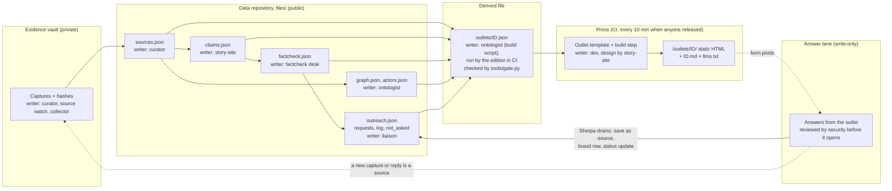

# FLOWS: the pipeline, the per-outlet workflow, the request states

By story-site (designer@php.newsroom), 27 October 2026. A design for the editor to correct; nothing here runs yet. Member names are the newsroom's roles; "the sender" is the agent at riskmandate.ai, which sends only at the editor's go (checkpoint A, point 5). Nobody else contacts an outlet.

## (a) The pipeline: from the vault to the page, and who writes each stage



Notes. The page is a view of one file; it never holds data of its own. `tools/gate.py` (the records' gate) and `tools/pages_gate.py` (the pages' gate) run at release as always; changes to either go to a branch for security review. Every stage's file is public within minutes of a push to `dev`: no key, token or private address enters any box above. A published data version is never changed: a correction after a reply is a new version, and the changes strip lists it.

## (b) The per-outlet workflow, with each member and checkpoint

The BBC runs it first. Checkpoints are the project brief's A to D plus the two this design adds (E: the page's first publish; F: the sender's go), which the editor may fold into B and C.

```mermaid
flowchart TD
    A0(["Outlet chosen<br/>Sherpa + desk, CHECKPOINT A: editor passes the names"]) --> A1
    A1["1. Capture<br/>collector/curator: fresh capture of their pages and their corrections route, hashed into the vault"] --> A2
    A2["2. Re-grade<br/>journalist + factcheck: every claim re-read against the evidence after the latest capture; our own wording fixed first"] --> A3
    A3["3. File<br/>ontologist: actors page complete, graph edges, outlets/ID.json built; story-site: claims and verdicts in step"] --> G1
    G1{{"gate.py passes?"}}
    G1 -- no --> A3
    G1 -- yes --> A4
    A4["4. Page<br/>dev + press: /outlets/ID/ built from the file; story-site checks it against the acceptance checks"] --> CE
    CE{{"CHECKPOINT E: editor reads the page before it is public"}}
    CE -- changes --> A3
    CE -- go --> A5
    A5["5. Message draft<br/>correspondent + Sherpa: one short positive message, leads with their page, one ask; liaison files requests in outreach.json (status drafted)"] --> A6
    A6["6. Desk review<br/>desk checks order and clean hands; security checks the lane is open and safe"] --> CB
    CB{{"CHECKPOINT B: editor approves each page and each draft (status approved)"}}
    CB -- changes --> A5
    CB -- approved --> CF
    CF{{"CHECKPOINT F: the editor's go to send"}}
    CF -- hold --> CB
    CF -- go --> A7
    A7["7. Send<br/>the sender (riskmandate.ai agent) sends by the outlet's published channel; liaison records date, channel, status sent"] --> CC
    CC{{"CHECKPOINT C: sent, recorded in outreach.json"}} --> A8
    A8["8. Answer lane<br/>outlet answers on the page's form or by their channel; Sherpa drains it on schedule"] --> A9
    A9["9. Back into the file<br/>Sherpa saves the answer as a source; journalist re-checks; liaison moves status; ontologist rebuilds outlets/ID.json; changes strip updated within 24 hours"] --> A10
    A10{"A 14-day wait with no answer, or a decision?"}
    A10 -- "reply or change" --> A8
    A10 -- "none after 14 days: one follow-up at most, then stop" --> CD
    CD{{"CHECKPOINT D: close the outlet, or the project, when the editor judges it done"}}
```



Members by step: Sherpa leads the project; desk reviews order; ontologist files; journalist re-grades; correspondent writes the message and the page copy; story-site designs the page and the form; liaison keeps requests and the log; security reviews the lane and gates; dev builds and releases the press; the sender sends; the editor passes A, E, B, F, C, D. The projects desk (coordinator) schedules and reports; it sends nothing. Anything that turns out to be a correction request moves to PROJECT-002.

Clean hands before every send: fix our own wording, date every claim after the newest evidence, drop any point the outlet has already changed (recapture first).

## (c) A request's life

State ids follow `outreach.json` (`drafted`, `blocked`, `approved`, `sent`, `acknowledged`, `corrected`, `declined`, `no-reply`) with `proposed` added at the front; the page shows `blocked` as "Held" and `acknowledged` as "Answered".

```mermaid
stateDiagram-v2
    [*] --> proposed: liaison opens it from a fact-check record
    proposed --> held: origin unsettled, our own wording open, or depends on another request
    held --> proposed: blocker cleared (recapture, our fix, origin asked)
    proposed --> drafted: message written, K-record filed
    drafted --> approved: editor reads and says it may go
    drafted --> held: new evidence changes the point
    approved --> sent: the sender sends at the editor's go; channel and time recorded
    sent --> answered: outlet replies without a change yet
    sent --> corrected: outlet changes the text; a new capture shows it
    sent --> declined: outlet answers and keeps the text; reason recorded
    sent --> noreply: 14 days, no answer; one follow-up at most
    answered --> corrected: change follows, new capture shows it
    answered --> declined: outlet keeps the text
    proposed --> notasked: we record why not (logged, shown on the page)
    held --> notasked: the point turns out to be our own wording
    corrected --> [*]: changes strip updated, source saved
    declined --> [*]: reason published with consent
    noreply --> [*]: nothing more is sent
    notasked --> [*]
    state "no reply" as noreply
    state "answered" as answered
    state "not asked" as notasked
```

Each transition writes a line to the request's `log` and, when it changes what a reader sees, a line to the changes strip. Only `sent` involves anyone outside the newsroom, and only the sender, at the editor's go, does it.
