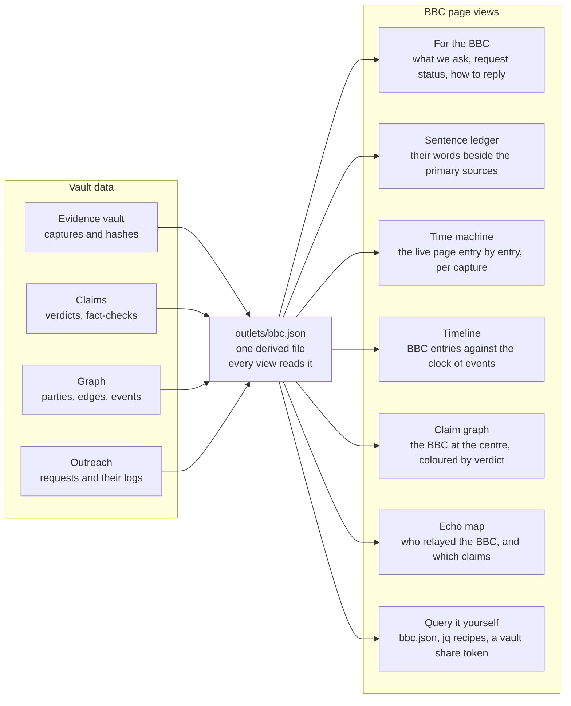

<!-- The editor's own input, given in the projects desk's session (projects@php.newsroom) on 27 October 2026 at about 12:28 UTC: a briefing written in another of the editor's sessions, uploaded here with the words "can you also process and take into account these notes … This is one of the many we need to do". Filed verbatim. The desk checked its figures against data dev c44b089 (12 claims cite bbc-live-ckgel5xp2xv9t; graph 1,775 nodes, 2,039 edges, party:bbc 14 out, 1 in; one BBC source, three vault captures; R-013 to R-015 unused; claim no-exploitation "reported"): all hold. It passes no checkpoint by itself; nothing in it is sent until the editor sends it. -->

# BBC Corrections Case Study — Conductor Briefing

Oct 27, 2026 · Dinis Cruz

## Mission

The conductor runs one case study: take the BBC's php2shell coverage from captured evidence to sent, tracked correction requests, and publish a dedicated BBC page that a BBC journalist or editor could land on and verify everything in minutes.

The BBC is the test case for a reusable pattern. Whatever we build here (data model, page template, liaison flow) should work unchanged for CNN, WIRED, Fortune and the other outlets already in outreach.json.

**Done means:**

- Every BBC-linked claim has a verdict, a fact-check record and a decision: ask for a correction, or record why not.
- Each request to the BBC is drafted, published on the site, and sent by the editor through a channel we have captured as evidence.
- A BBC case-study page is live on the PHP site, rebuilt from the vault like every other page.
- A BBC reader can answer three questions without help: what we say is wrong, how we know, and what changed since.

## What we already hold on the BBC

We hold one BBC page in depth, the live page, plus one request and twelve linked claims. Two other BBC items (the NSA X-post entry and the Radio 4 interview) are described but not archived as sources of their own.

**The source:** [bbc-live-ckgel5xp2xv9t](https://refs.php.oct.2026.newsroom.sgit.ai/sources/bbc-live-ckgel5xp2xv9t/), "PHP: Global scramble to fix critical cyber-security flaws as many websites taken offline". First published 22 Oct 06:16:24 UTC; editors Kieran Kelly and Imogen James.

| Capture | Status | What it holds |
| --- | --- | --- |
| Raw curl, 07:55Z | Complete | page HTML + `initial-data.json` (the BBC's `__INITIAL_DATA__`), 12 posts, 07:15 to 08:50 BST |
| 20261022T080453Z | Partial | rendered HTML, screenshot, text; raw body missing (24-byte stub) |
| 20261022T080526Z | Partial | as above |
| 20261022T080559Z | Complete | raw + rendered HTML, screenshot, text (hash `c88b8c5f…`) |

All four captures fall inside about ten minutes on the morning of 22 Oct. We have **no capture after 08:06Z**, so we cannot say what the live page says now, or whether the BBC has already edited the entries we would challenge.

**Claims citing the page (12):**

| Claim | Attributed to | Verdict |
| --- | --- | --- |
| Flaws disclosed on 22 October | BBC framing | Contradicted |
| UK, NSA, EU and Australian agencies advise taking systems offline | BBC | Contradicted |
| NCSC quote on taking systems offline | NCSC, via BBC | Disputed |
| 70% of the Internet affected | Wiz, via BBC | Unverified |
| Criminals use AI to "vibe code" an attack | Unnamed researchers | Unverified |
| No evidence yet of exploitation | Ryan Austin, Calif (Radio 4) | Reported; fact-check says disputed |
| About 30 million websites could be affected | Alan Woodward | Reported |
| Frontier AI found the flaws (Patch the Planet) | OpenAI, Calif, Wiz | Reported |
| Most severe flaws ever found by AI | Wiz, via BBC | Reported |
| Calif mistakenly published a video around 20:00 UTC, 20 Oct | PHP Foundation | Reported |
| Wikipedia, Edinburgh council, French government sites, Geneva University, shops and the BBC affected | BBC | Reported |
| Amazon and Cloudflare saw probing | Woodward; both companies | Confirmed |

**The request:** R-002 ("roughly 70%" attributed to Wiz). Drafted 22 Oct, ready 24 Oct, waiting on R-001 (Wiz). Channel field: still to be found.

## The BBC's correction channels

The BBC route is "BBC First": a complaint through the BBC's own complaints process, escalating inside the BBC before any regulator. The clock that matters is **30 working days from when the content first appeared online**, which for the 22 Oct live page lands around 3 Dec 2026.

| Stage | Who handles it | Notes |
| --- | --- | --- |
| Stage 1a | BBC Audience Services | The first written complaint. The BBC may send a generic reply when many people complain about the same thing. |
| Stage 1b | The responsible editorial team | For when the 1a reply does not address the point. |
| Stage 2 | Executive Complaints Unit (ECU) | Formal finding. The ECU can investigate points the stage 1 replies missed, and publishes upheld and resolved findings. |
| After the ECU | Ofcom | Only after the ECU's final reply, or if the BBC misses its own deadlines. For BBC website content, Ofcom gives a published opinion, and the BBC decides what to do. Ofcom cannot order a correction. |

**What changed in 2025–26:** the December 2025 update to the BBC Agreement extends Ofcom's role over BBC online material, including news sites. The new regime only covers material posted after Ofcom publishes its first procedure. Ofcom consulted on an online code until 27 Aug 2026, with decisions due later in 2026. Whether the 22 Oct live page falls under the new or old regime is an open question for the liaison desk.

**Which route fits which issue:**

- The disclosure date and the NCSC quote are plain factual errors on a live page. Stage 1a is the right first step, asking for a correction on the page itself.
- The "agencies advise offline" summary and the "roughly 70%" wording are framing issues. They should go in the same Stage 1a submission as numbered points, not as separate complaints.
- Escalate to Stage 2 only if the BBC declines a point that our primary evidence settles.

**Still to verify and capture before sending:**

- [ ] Capture the BBC complaints page and form as dated evidence. Direct fetch was blocked from this session, so the liaison desk's capture pipeline should take it.
- [ ] Confirm the BBC still runs a public Corrections and Clarifications page, and capture it.
- [ ] Re-capture the live page today. Our latest capture is 22 Oct 08:06Z, so the BBC may already have fixed some points.
- [ ] Decide whether a courtesy note to the live page's editors comes before the formal complaint. The runbook currently allows only the publisher's published channel, so this needs the editor's call.

Sources: [Ofcom, how it deals with BBC complaints](https://www.ofcom.org.uk/tv-radio-and-on-demand/broadcast-standards/how-ofcom-deals-with-bbc-complaints) · [GOV.UK, BBC Agreement update, Dec 2025](https://www.gov.uk/government/publications/bbc-charter-and-framework-agreement/updates-to-bbc-framework-agreement-december-2025) · [Advanced Television, Ofcom consults on BBC online regulation, 2 Jul 2026](https://www.advanced-television.com/2026/07/02/ofcom-consults-on-bbc-regulation-2/) · [CAMERA UK, BBC Complaints Framework, 2020](https://camera-uk.org/2020/06/11/new-bbc-complaints-framework-comes-into-effect/)

## Correction requests to open

Open three new BBC requests and send all four as one numbered Stage 1a submission. Points 1 and 2 are the strongest and do not depend on Wiz, so the submission should not wait for R-001.

| Order | Id | Claim | Evidence we need in hand | Suggested fix | Depends on |
| --- | --- | --- | --- | --- | --- |
| 1 | R-013 (new) | Flaws "disclosed on 22 October" | php.net advisory, PHP Foundation release post and php-src 8.5.12 tag, all 21 Oct, 14:00 UTC | Say the fixes were released on 21 Oct | None |
| 2 | R-014 (new) | NCSC quoted advising taking systems offline "where immediate remediation is not feasible" | NCSC page as captured 22 Oct 08:09Z, plus a fresh capture and the page's own change history if any | Use the NCSC's actual wording, or attribute the line to its real source | Fresh NCSC capture |
| 3 | R-015 (new) | UK, NSA, EU and Australian agencies advise taking systems offline | 16-agency comparison; ACSC gives no offline advice; CERT-EU says isolate | Say agencies urge patching now, and some advise isolating or taking systems offline | None |
| 4 | R-002 | "Roughly 70%" attributed to Wiz | Wiz blog and X post; site claim scale-70pc-internet | Quote Wiz's words, and say the figure is the share of websites using PHP | R-001 sent first, or note in the submission that Wiz has been asked too |

**Hold R-014 until the quote's origin is settled.** The source notes show the NCSC page was modified at 07:30:02 GMT on 22 Oct, after the BBC page opened. Canada's CCCS alert AL26-026 opens with the same words the BBC attributes to the NCSC, and the notes say the wording is shared across Five Eyes and CERT-EU texts. The BBC may have quoted an earlier NCSC version or a joint text. Find an earlier NCSC capture (Wayback, CDN cache, NCSC change log) before calling it a misquote. If the wording turns out to be shared text, the request becomes a question about attribution, not a correction.

**Candidates found in the source notes, not yet claims:**

| Candidate | What the notes say | Next step |
| --- | --- | --- |
| "Most severe flaws ever detected by AI" (Wiz) | The phrase is not on Wiz's blog; the closest wording is hedged with "arguably" | Quote-check both Wiz captures; if confirmed, a candidate R-016 |
| "One of the most impactful security issues in recent memory" (OpenAI) | Wording differs from OpenAI's X post | Diff the exact strings; probably too small to ask about alone |
| "PHP Foundation joined Patch the Planet in July" | The Foundation's own account differs; Calif says the invitation came by 30 Jul | Make a claim; check the Foundation's wording |
| "Calif found it in August, OpenAI and Wiz shortly after" | The PHP Foundation says OpenAI reported independently; the order is disputed | Make a claim; keep as context unless primary sources settle the order |

**Not asking, with reasons to record:**

- The 30 million websites figure. It is Woodward's estimate, attributed to him, so the attribution is correct even though no basis is given.
- "Vibe coding" by criminals. It is unverified, but attributed to researchers. Log it as a question to ask the BBC who the researchers are, not as a correction.
- "No evidence yet of exploitation". This was true when said, at 07:00 UTC on 22 Oct. Fix our own status mismatch first: the claim shows "reported" but its fact-check says "disputed".

**Before anything is sent:** re-capture the live page and drop any point the BBC has already corrected. Each new request needs its K-record on /factcheck/, as the runbook requires.

## The BBC case-study page

Build `/outlets/bbc/` as a "BBC file". Its first screen answers what we say is wrong, how we know, and what we have asked for. Every view below it reads one derived file, so the page never drifts from the vault. Make it a template: `/outlets/<id>/` for every outlet in outreach.json.



The vault stays the single source of truth. The page is a set of views over one file, which an outside reader can download and query too.

**Who arrives, and what they need first:**

| Visitor | Arrives from | Needs on the first screen |
| --- | --- | --- |
| Live-page journalist or editor | Link in our Stage 1a submission | The exact sentence, our evidence, our suggested words |
| Complaints handler or ECU | A complaint reference | Numbered points, capture times, hashes, primary links |
| BBC Verify or a fact-check desk | Social media or a tip | Method, how to reproduce, raw data |
| Our readers and other outlets | The newsroom front page | Why we asked, current status, what changed |

**The seven views:**

1. **For the BBC.** Four numbered points, each laid out as "you said / the primary source says / we suggest". Each shows a verdict chip, the request status and our latest capture time. It also gives a reply route, and says what we do with a reply: publish it with consent and update the status within 24 hours.
2. **Sentence ledger.** All 12 BBC sentences we cite, not only the disputed ones, each beside the primary quote and filterable by verdict. Showing the confirmed rows is what makes the page read as fair, not hostile.
3. **Time machine.** A Wayback-style view of the live page, rebuilt entry by entry from `__INITIAL_DATA__`. A scrubber moves across captures (07:55Z, 08:04Z, 08:05Z, then today), with per-entry diffs and per-file hashes. Screenshots stay private. Instead, the BBC can get a read-only sgit share token for the capture folders.
4. **Timeline.** Two lanes, BBC entries against world events: the release (21 Oct, 14:00 UTC), the NCSC page change (22 Oct, 07:30 GMT), the NSA X post and the Radio 4 interview. The date and NCSC issues show at a glance.
5. **Claim graph.** An ego graph around `party:bbc`. The BBC links to its claims, coloured by verdict, then to primary sources and captures. It reuses the existing graph renderer, filtered to bbc.json.
6. **Echo map.** Which outlets relayed which BBC claim, when, and in which language. A Sankey from claims to outlets, plus a time strip. The notes already show at least nine relays across six languages. This view answers why a correction matters beyond one page.
7. **Query it yourself.** `outlets/bbc.json`, the jq recipes, a markdown copy, llms.txt, and a legend for the ontology (12 node kinds, 15 edge verbs), so any line can be traced to a hash.

Add a changes strip along the bottom, versioned like /versions/. If the BBC edits its page or replies, the change and the time it was recorded are visible to everyone.

## Research brief for the researcher agent

The archive holds more BBC material than the one source page shows, but most of it sits in free-text notes rather than in the graph. I pulled the published data files on 27 Oct and queried them. This is what the graph models and what it misses.

**What the data shows today:**

- `sources.json`: 598 rows, **one** BBC source. 21 other sources mention the BBC in `notes` or `notes_md` only.
- `graph.json`: 1,775 nodes, 2,039 edges. `party:bbc` has 14 outgoing edges (11 `relays`, 3 `states`) and one incoming `published_by`. **No other outlet links to it.**
- `outreach.json`: R-002 is well formed, with the exact quote, capture path and sha256. `channel.kind` is still "to find".
- Plain search on `bbc` in `sources.json` gives about 60 false hits inside sha256 hex. Search the named fields, never the raw JSON.

**Gaps to close (each becomes a vault change, not a page edit):**

1. **The echo network.** At least 9 outlets relay the BBC in their notes: Cairo24, Koran Jakarta, Al-Masry Lite, Media Indonesia, ITWeb, HomoDigital, Revista Sociedade Militar, startupper and Uzone. Add `relays`/`syndicates` edges from each to `party:bbc`, and record which BBC claim each one carries. This shows how far a BBC error travelled.
2. **The BBC as an affected party.** Il Sole 24 Ore, startupper, Uzone and VietNamNet report BBC pages going offline. Add an event and an `affected` link, with a BBC primary source if one exists.
3. **BBC sources we do not hold.** The Radio 4 interview (07:00 UTC, 22 Oct), the NSA X-post entry, the BBC technology editor's and cyber correspondent's pieces quoted by HomoDigital and ITWeb, and any BBC article pages (not live), BBC Verify, BBC World Service language services and BBC Sounds clips. Search, capture and add each as its own source.
4. **Live page history.** We have four captures, all from 22 Oct 07:55–08:06Z. We need a fresh capture today, Wayback snapshots if any exist, and a per-entry diff. The `__INITIAL_DATA__` JSON holds entry ids and timestamps, so diff by entry id, not by page text.
5. **The NCSC quote.** Find earlier versions of the NCSC page (before 07:30:02 GMT on 22 Oct) and the joint Five Eyes text. Decide whether R-014 is a misquote or a shared-text attribution.
6. **Parties not modelled.** The two live-page editors, the BBC technology editor and the BBC cyber correspondent appear in the notes but not in `entities.json`. Add them as `works_for` parties, so the page can show who said what.
7. **Our own inconsistency.** Claim `no-exploitation` shows "reported", while the fact-check says "disputed". Fix this before any BBC reader sees it.

**Query recipes the page and the agents should share:**

```
# every BBC-linked thing, from the published graph
jq '.edges[] | select(.from=="party:bbc" or .to=="party:bbc" or .to=="source:bbc-live-ckgel5xp2xv9t")' graph.json

# sources that mention the BBC in their notes (not in hashes)
jq '.[] | select((.notes // "") + (.notes_md // "") | test("\\bBBC\\b")) | {slug, publisher, published}' sources.json

# the BBC request(s)
jq '.requests[] | select(.actor=="bbc")' outreach.json
```

Recommendation: publish one derived file, `data/latest/outlets/bbc.json`. It should be the subgraph above plus captures, requests and the echo network, so the page, the liaison desk and an outside reader all query the same thing.

## Workstreams for the conductor

Run four workstreams in parallel. The only hard sequence is: fresh capture first, then requests, then send.

| Workstream | Owner role | First deliverable | Done when |
| --- | --- | --- | --- |
| Capture | Source watch / collector | Fresh live-page capture, BBC complaints page and corrections page captured, NCSC history pulled | Every item in gap 3 and 4 is a source with captures |
| Model | Researcher / librarian | Echo edges, affected-party event, new parties, `outlets/bbc.json` | The jq recipes return the echo network and the new sources |
| Liaison | Liaison desk | R-013, R-015 opened from K-records; R-014 held with its question; one Stage 1a draft | The editor approves the draft and the channel is captured |
| Page | Site builder | `/outlets/bbc/` built from `outlets/bbc.json` | The acceptance checks below pass |

**Guardrails (from the runbook, restated for this case):**

- No agent contacts the BBC. The editor sends, personally, through the captured channel.
- Every request is published on /outreach/ before it is sent.
- One follow-up at most; stop after 14 days without a reply. Mind the BBC's 30-working-day window, around 3 Dec 2026.
- Quotes on our page stay short and point to our captures. We do not republish the BBC's page text or screenshots publicly; captures stay in the private vault, with hashes shown.
- Disclose our own interests on the BBC page, as the site already does.

**Acceptance checks for the BBC page:**

- [ ] A BBC reader can find each disputed sentence, our evidence and our suggested wording within two clicks of landing.
- [ ] Every number on the page comes from `outlets/bbc.json` and matches the jq recipes.
- [ ] The page shows the date of our latest capture, and flags if it is older than 24 hours.
- [ ] Each request shows its status and full log, including "not asked" with reasons.
- [ ] The page has a reply route for the BBC, and says what we will do with a reply.
- [ ] The page works at phone width and without JavaScript, falling back to static tables.
